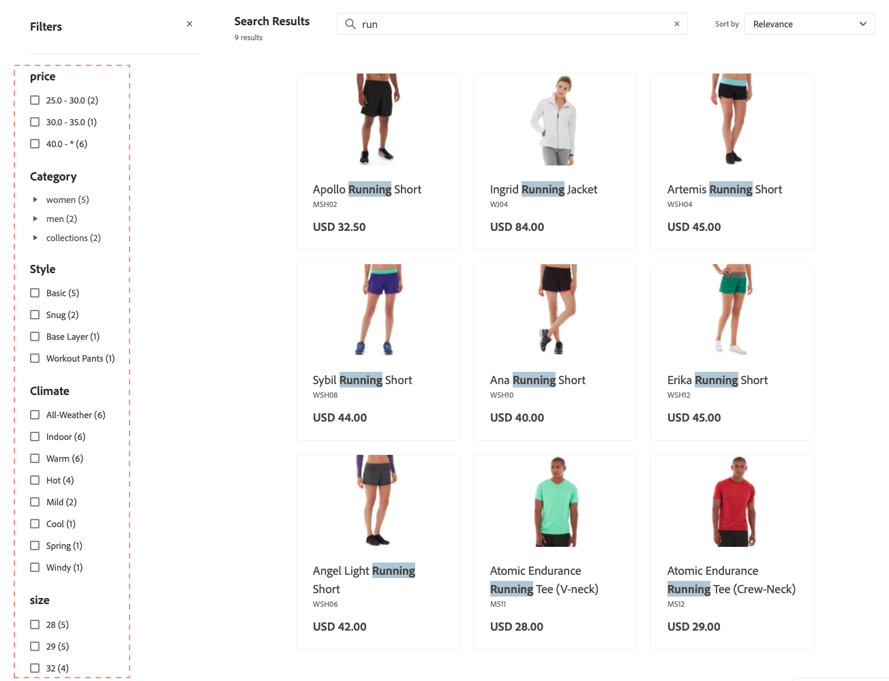

Facetten ist eine Methode zur Hochleistungsfilterung, bei der mehrere Dimensionen von Attributwerten als Suchkriterien verwendet werden.

Innerhalb einer Facette können Käufer mehrere Optionen auswählen, z. B. „Einfach“ und „eng“ unter „Stil“ und die Suchergebnisse werden aktualisiert, um nur diese Stile anzuzeigen. Wenn ein Käufer „Standard“ unter „Stil“ und „Innenbereich“ unter „Klima“ auswählt, zeigen die Suchergebnisse diese Auswahl an.

Jede definierte Facette kann als URL-Parameter verwendet werden. Die Ergebnisse werden anhand der Parameterwerte gefiltert, zum Beispiel: `http://yourstore.com?brand=acme&color=red`.

## Facettenaggregation

Die Facettenaggregation wird wie folgt durchgeführt: Wenn die Storefront drei Facetten hat (Kategorien, Farbe und Preis) und die Käufer alle drei filtern (Farbe = Blau, Preis ist von $10.00-$50.00, `categories` = `promotions`)

- `categories` Aggregation (aggregation) - Aggregiert `categories` und wendet dann die `color`- und `price` an, jedoch nicht den `categories`.
- `color` Aggregation (aggregation) - Aggregiert `color` und wendet dann die `price`- und `categories` an, jedoch nicht den `color`.
- `price` Aggregation (aggregation) - Aggregiert `price` und wendet dann die `color`- und `categories` an, jedoch nicht den `price`.

## Standard-Attributwerte

Das System aktiviert standardmäßig die folgenden Produktattribute.

| Eigenschaft | Beschreibung | Attribut |
|---|---|---|
| sortierbar | Wird zum Sortieren in der Produktliste verwendet | `price` |
| durchsuchbar | In Suche verwenden | `price`  `sku` `name` |

Weitere Informationen zu Produktattributen und ihren Eigenschaften:

- Informationen zu Bereitstellungen, die mit einem Adobe Commerce-Backend verbunden sind, finden Sie unter [Übersicht über Produktattribute](https://experienceleague.adobe.com/en/docs/commerce-admin/catalog/product-attributes/product-attributes)
- Informationen zu Bereitstellungen mit einem Commerce-Backend eines Drittanbieters finden Sie unter [Datenaufnahme-Metadaten-API](https://developer.adobe.com/commerce/services/optimizer/data-ingestion/#metadata).

## Mehrschichtige Suche und Erweiterung von Suchtypen

Die mehrschichtige Suche oder Suche innerhalb einer Suche ist ein attributbasiertes Filtersystem, das die herkömmliche Suchfunktion um zusätzliche Suchparameter erweitert. Diese zusätzlichen Suchparameter ermöglichen eine präzisere und flexiblere Produktsuche.

Mit der mehrschichtigen Suche können Sie:

- Ermöglichen Sie es Käufern, innerhalb der Suchergebnisse zu suchen.
- Verfeinern Sie die Ergebnisse weiter, indem Sie die Suchindizierung `startsWith` und `contains` in der zweiten Ebene der mehrschichtigen Suche verwenden.

Die erweiterten Suchfunktionen werden über den `filter`-Parameter in der [`productSearch`-Abfrage mithilfe ](https://developer.adobe.com/commerce/services/reference/graphql/#productsearch) Operatoren implementiert:

- **Mehrschichtige Suche** - Suchen in einem anderen Suchkontext - Mit dieser Funktion können Sie bis zu zwei Suchebenen für Ihre Suchabfragen durchführen. Beispiel:

  - **Layer 1-Suche** - Suche nach „motor“ auf `product_attribute_1`.
  - **Layer 2-Suche** - Suchen Sie in `product_attribute_2` nach „Part number 123“. In diesem Beispiel wird in den Ergebnissen nach „Motor“ nach „Teilenummer 123“ gesucht.

  Die mehrschichtige Suche ist sowohl für die `startsWith` als auch für die `contains` Suchindizierung in der zweiten Ebene der mehrschichtigen Suche verfügbar, wie unten beschrieben:

- **startsWith search indexation** - Suche mit `startsWith`. Diese Funktion ermöglicht Folgendes:

  - Suchen nach Produkten, bei denen der Attributwert mit einer angegebenen Zeichenfolge beginnt.
  - Konfigurieren der Suche „endet mit“, damit Käufer nach Produkten suchen können, bei denen der Attributwert mit einer bestimmten Zeichenfolge endet.
    - Um eine Suche „endet mit“ zu aktivieren, nehmen Sie das Produktattribut in umgekehrter Reihenfolge auf und verwenden Sie eine umgekehrte Zeichenfolge für den API-Aufruf. Wenn Sie beispielsweise nach einem Produktnamen suchen möchten, der mit „pants“ endet, müssen Sie dies als „stnap“ senden.

- **enthält Suchindizierung** - Suchattribut mit enthält Indizierung. Diese neue Funktion ermöglicht Folgendes:

  - Suchen nach einer Abfrage innerhalb einer größeren Zeichenfolge. Beispiel: Ein Käufer sucht in der Zeichenfolge „HAPE-123“ nach der Produktnummer „PE-123“.

    - Hinweis: Dieser Suchtyp unterscheidet sich von dem vorhandenen Suchbegriff[ der eine ](https://developer.adobe.com/commerce/services/reference/graphql/#productsearch) Suche durchführt. Wenn Ihr Produktattributwert beispielsweise „Outdoor Pants“ ist, gibt eine Suchphrase eine Antwort für „out pan“ zurück, aber keine Antwort für „or ants“. Eine Suche enthält jedoch eine Antwort für „oder Ameisen“.

Diese neuen Bedingungen verbessern den Filtermechanismus für Suchanfragen, um Suchergebnisse zu verfeinern. Diese neuen Bedingungen wirken sich nicht auf die Hauptsuchabfrage aus.

### Implementierung

1. [Attribute als durchsuchbar festlegen](https://developer.adobe.com/commerce/services/reference/rest/#tag/Metadata).

1. Geben Sie die Suchfunktion für dieses Attribut an, z. B **„Enthält** (Standard) oder **Beginnt mit**. Um **Enthält** und **Beginnt mit** zu aktivieren, geben Sie jeweils maximal sechs Attribute an. Darüber hinaus ist für die **Enthält**-Indizierung die Zeichenfolgenlänge auf 50 Zeichen oder weniger begrenzt.

1. In der [Entwicklerdokumentation](https://developer.adobe.com/commerce/services/reference/graphql/#productsearch) finden Sie Beispiele dazu, wie Sie Ihre Adobe Merchandising Services GraphQL-API-Aufrufe mithilfe der neuen `contains` und `startsWith` Suchfunktionen aktualisieren können.

   Sie können diese neuen Bedingungen auf Ihrer Suchergebnisseite implementieren. Sie können beispielsweise einen neuen Abschnitt auf der Seite hinzufügen, in dem der Erstkäufer seine Suchergebnisse weiter verfeinern kann. Sie können Käufern die Auswahl bestimmter Produktattribute ermöglichen, z. B. „Hersteller“, „Teilenummer“ und „Beschreibung“. Von dort aus suchen sie mithilfe der `contains` oder `startsWith` Bedingungen innerhalb dieser Attribute.

### Verwendung der mehrschichtigen Suche anstelle von Facetten

Die mehrschichtige Suche und Facetten dienen verschiedenen Zwecken der Produktsuche. Die Auswahl zwischen ihnen hängt von Ihrem spezifischen Anwendungsfall ab:

**Verwenden Sie die mehrschichtige Suche, um:**

- Suchen in Suchergebnissen mit mehreren Kriterien
- Arbeiten mit Teilenummern, SKUs oder technischen Spezifikationen, wenn Benutzende nur teilweise Informationen kennen
- Kunden ermöglichen, die Ergebnisse anhand verschachtelter Kriterien Schritt für Schritt einzugrenzen
- Verringern Sie die Anzahl der API-Aufrufe, indem Sie mehrere Suchkriterien in einer einzigen Abfrage kombinieren.
- Implementieren Sie geschäftsspezifische Suchmuster, die über die standardmäßige Facettennavigation hinausgehen

**Verwenden von Facetten für:**

- Typische Kategorie-, Preis-, Marken- und Attributfilter bereitstellen
- Bieten Sie intuitive Filteroptionen, die Benutzerinnen und Benutzer leicht verstehen und auswählen können
- Verfügbare Optionen basierend auf aktuellen Suchergebnissen anzeigen
- Anzeigen von Filterzählungen und -bereichen, die Benutzern das Verständnis der verfügbaren Optionen erleichtern
- Arbeiten mit allgemeinen Produktmerkmalen wie Farbe, Größe und Material

**Best Practice:** Verwenden Sie die mehrschichtige Suche für komplexe, technische Suchen, bei denen Benutzende bestimmte Kriterien haben, und verwenden Sie Facetten für die standardmäßige E-Commerce-Filterung, bei der Benutzende Optionen visuell erkunden und verfeinern möchten.
