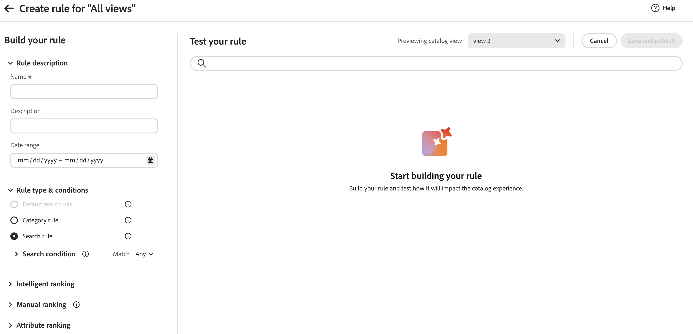
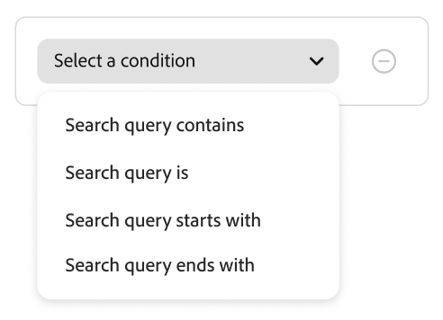
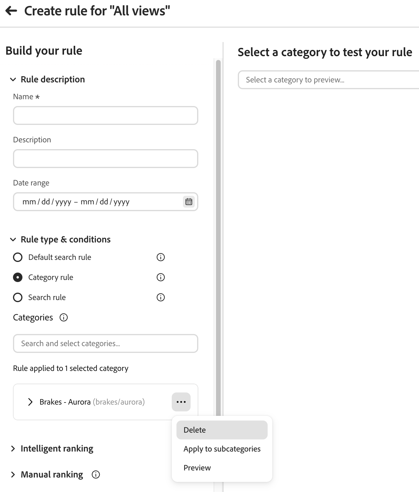
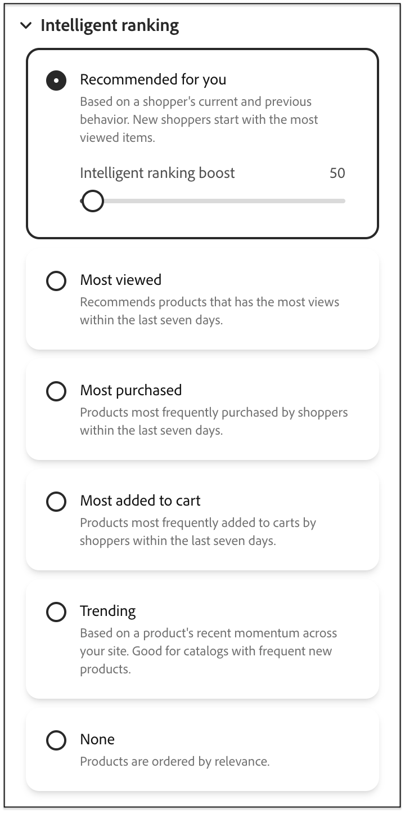
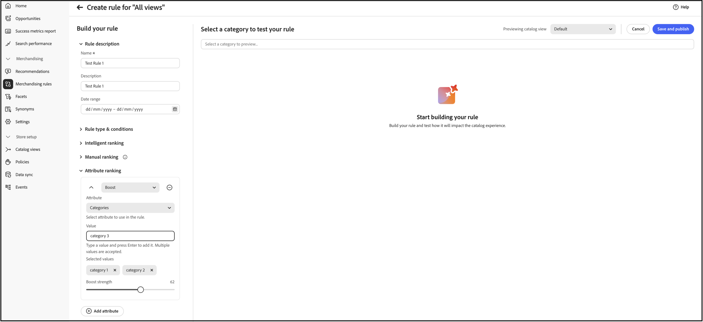

Zum Erstellen einer Regel müssen Sie die Katalogansicht auswählen, für die die Regel gilt, die Regelbeschreibung konfigurieren, den Typ angeben, die Bedingungen und das Ranking definieren, die Ergebnisse testen und die Regel veröffentlichen.

## Erstellen einer Regel {#create-a-rule}

1. Navigieren Sie im Menü zu _Merchandising_ > **Merchandising-Regeln**.
1. (Optional) Wählen Sie im Dropdown-Menü **Katalogansicht“ die Katalogansicht aus, für** die Regel gilt.
Die von Ihnen erstellte Regel wird auf die ausgewählte Ansicht beschränkt (oder auf alle Katalogansichten, wenn **Alle Ansichten** ausgewählt ist). Siehe [Auswählen der &#x200B;](workspace.md#select-catalog-view)), wie der Umfang der Katalogansicht funktioniert.

1. Klicken Sie auf **[!UICONTROL Create rule]** , um den Regeleditor zu starten.

   {zoomable="yes"}

### Regeltypen

Jeder Regeltyp verfügt im Editor über ein Informationssymbol mit einer kurzen Erläuterung. Verwenden Sie den Typ, der dem entspricht, in dem Käufer die Merchandising-Logik sehen:

| Regeltyp | Zweck |
| --- | --- |
| **Standardsuchregel** | Standard-Ranking und Merchandising in allen Produktlisten, wenn keine spezifischere Such- oder Kategorieregel gilt. Sie können nur eine solche Regel erstellen; sie kann keine Bedingungen enthalten. |
| **Kategorieregel** | Wendet Merchandising und Ranking auf eine einzelne Kategorie an und steuert die Produktbestellung auf dieser Kategorieseite. |
| **Suchregel** | Wendet Merchandising und Ranking an, wenn Käufer eine Suche ausführen, die den Abfragebedingungen der Regel entspricht. |

Im Abschnitt **Regel erstellen** definieren Sie den Regelnamen, den Zeitplan, unabhängig davon, ob die Regel für alle Listen oder für bestimmte Suchbedingungen gilt, sowie Ranking-Typen.

1. Geben Sie im Feld **[!UICONTROL Name]** einen Namen für die Regel ein. Alle Regelnamen müssen eindeutig sein.
1. Geben Sie im Feld **[!UICONTROL Description]** eine Beschreibung für die Regel ein.
1. Geben Sie im Feld **[!UICONTROL Date range]** das Datum oder den Datumsbereich an, zu dem die Regel aktiv sein soll.
1. Wählen Sie im Abschnitt **[!UICONTROL Rule applies to]** den [Regeltyp](#rule-types) aus, den Sie verwenden möchten.

>[!BEGINTABS]

>[!TAB Suchregel]

Eine Suchregel wendet eine Merchandising- und Ranking-Logik an, wenn Käufer eine Suche durchführen, die den definierten Bedingungen entspricht.

Die Bedingungen sind die Voraussetzungen für den Trigger eines Ereignisses. Eine Regel kann bis zu zehn Bedingungen und 25 Ereignisse enthalten. Eine Standardregel darf keine Bedingungen enthalten.

{zoomable="yes"}

**Einzel-Bedingung**

1. Wählen *unter „Regel erstellen* die **Bedingung** aus und befolgen Sie die Anweisungen, um die Anweisung abzuschließen.

   - Suchanfrage enthält - Geben Sie die Textzeichenfolge ein, die in der Abfrage des Erstkäufers enthalten sein muss. Die Einstellung Übereinstimmung bestimmt das Ausmaß, in dem die Abfrage des Käufers mit dem Katalog übereinstimmt. Optionen:  Beliebig - Jeder Teil des Abfragetextes des Käufers kann mit der Bedingung übereinstimmen. Alle - Alle Abfragen des Käufers müssen mit der Bedingung übereinstimmen.
   - Suchabfrage ist - Geben Sie eine Textzeichenfolge ein, die genau mit der Abfrage des Erstkäufers übereinstimmt. Zum Beispiel: „Yogahose“. Regeln mit den `All` &quot;`Search query is`&quot; und „Übereinstimmung“ können nur eine Bedingung haben.
   - Suchabfrage beginnt mit - Geben Sie ein Zeichen oder eine Zeichenfolge ein, die am Anfang der Abfrage des Erstkäufers stehen muss.
   - Suchanfrage endet mit - Geben Sie ein Zeichen oder eine Textzeichenfolge ein, die am Ende der Abfrage des Erstkäufers stehen muss.

   Im *Regelbereich testen* werden die Ergebnisse sofort nach Priorität nummeriert angezeigt. Mit dem Schieberegler *Ergebnisse pro Zeile* oben rechts können Sie die Anzahl der Produkte in jeder Zeile ändern.

1. Um andere Abfragen zu testen, ändern Sie den Abfragetext im Suchfeld *Regel testen* und drücken Sie **Return**.
Zunächst rendert der Testbereich die Abfrage aus dem Suchfeld Bedingungen . Die Abfrage wird jetzt jedoch aus dem Feld Testabfrage gerendert. Im Testbereich wird jeweils nur eine Abfrage gerendert.
1. Wenn Ihnen das Ergebnis gefällt, aktualisieren Sie den Text im Suchfeld *Bedingungen* . Klicken Sie dann auf eine beliebige Stelle auf der Seite, um die Ergebnisse im Testbereich zu aktualisieren.
1. Wählen Sie optional [Intelligente Rangfolge](#intelligent-ranking), [Manuelle Rangfolge](#manual-ranking) oder [Attributrangfolge](#attribute-ranking) aus, wie in den folgenden Abschnitten beschrieben. Die gleichen Steuerelemente gelten für Kategorieseiten, wobei alle Unterschiede hervorgehoben werden.

**Mehrere Bedingungen**

1. Um eine Regel mit mehreren Bedingungen zu erstellen, klicken Sie auf **Bedingung hinzufügen**.
Eine Regel kann bis zu zehn Bedingungen enthalten. Der logische Operator, der zwei Bedingungen verknüpft, basiert auf der aktuellen Einstellung *Übereinstimmung*. Standardmäßig ist *Match* `All` und der logische Operator ist `AND`.

1. Wählen Sie die zweite Bedingung aus und geben Sie den erforderlichen Abfragetext ein.

1. Um die Logik der Regel zu ändern, ändern Sie die Einstellung **Übereinstimmung**, um zu bestimmen, wie genau die Suchkriterien des Käufers mit der Abfragebedingung übereinstimmen müssen. Legen **Match** auf eine der folgenden Einstellungen fest:

   - Beliebig - (Standard) Alle logischen Operatoren in der Regel sind auf `OR` festgelegt, und die Ergebnisse werden im Testbereich angezeigt.
   - Alle - Alle logischen Operatoren in der Regel sind auf `AND` festgelegt, und die Ergebnisse werden im Testbereich angezeigt.

   Der *Match*-Wert bestimmt den logischen Operator, der zum Verbinden mehrerer Bedingungen verwendet wird. Durch Ändern der *Übereinstimmung*-Einstellung werden alle logischen Operatoren in der Regel geändert. `AND` und `OR` können nicht in derselben Regel kombiniert werden.

   In diesem Beispiel gibt es zwei separate Abfragen, die nach „Yoga“ oder „Hose“ suchen, anstatt nach „Yoga-Hose“ zu suchen. Diese Regel ist weniger spezifisch und wird in der Storefront häufiger ausgelöst als in der anderen Regel.

1. Um eine weitere Bedingung hinzuzufügen, klicken Sie auf **Bedingung hinzufügen** und wiederholen Sie den Vorgang.
1. Wählen Sie optional [Intelligente Rangfolge](#intelligent-ranking), [Manuelle Rangfolge](#manual-ranking) oder [Attributrangfolge](#attribute-ranking) aus, wie in den folgenden Abschnitten beschrieben. Die gleichen Steuerelemente gelten für Kategorieseiten, wobei alle Unterschiede hervorgehoben werden.

>[!TAB Kategorieregel]

Kategorieregeln steuern, wie Produkte auf (Kategorieseiten **bestellt**. Kombinieren Sie **Kategorieregeln** mit **intelligentem Ranking** und **manuellen**, um Discovery zu kuratieren, Promotions auszuführen und Kategorieseiten an Ihrer Strategie auszurichten.

**Kategorien auswählen**

Wählen **unter** eine oder mehrere Kategorien für die Regel aus. Ausgewählte Kategorien werden unter dem Steuerelement angezeigt, sodass Sie den Umfang bestätigen können. Wählen Sie Kategorien auf eine der folgenden Arten aus:

- **Kategoriestruktur durchsuchen** - Um unmittelbar untergeordnete Kategorien zu laden, erweitern Sie eine Kategorie. Um zu einer tieferen Ebene zu navigieren, erweitern Sie die untergeordnete Kategorie. Die Struktur wird jeweils nur eine Ebene geladen.
- **Nach Kategorienamen suchen** - Geben Sie einen Kategorienamen in das Feld **Nach Kategorien suchen und auswählen** ein. Die Suchergebnisse enthalten übereinstimmende Kategorienamen aus dem gesamten Katalog, einschließlich Kategorien außerhalb der aktuell erweiterten Verzweigung. Die Suche stimmt nicht mit dem Kategoriepfadtext überein.

Wenn mehrere Kategorien ähnliche Namen haben, verwenden Sie den mit jedem Ergebnis angezeigten Kategoriepfad (z. B. `brakes/aurora`), um die richtige Kategorie auszuwählen.

>[!NOTE]
>
>Beim Erweitern einer Kategorie werden nur die untergeordneten Kategorien zum Durchsuchen geladen. Die Kategorie wird nicht ausgewählt und die Regel wird nicht auf die Unterkategorien angewendet. Wählen Sie eine Kategorie aus, um sie der Regel hinzuzufügen. Um die Regel auf die Unterkategorien einer Kategorie anzuwenden, verwenden Sie **Auf Unterkategorien anwenden** aus dem Aktionsmenü der Kategorie, das unten beschrieben wird.

>[!TIP]
>
>Wenn eine untergeordnete Kategorie nicht sichtbar ist, erweitern Sie die übergeordnete Kategorie, um die nächste Ebene zu laden. Wenn Sie den Kategorienamen kennen, verwenden Sie das Suchfeld, anstatt durch die Baumstruktur zu navigieren. Dieses Verhalten ist für große Kataloge nützlich, da Kategorieebenen bei Bedarf geladen werden.

1. Klicken Sie in der Liste der ausgewählten Kategorien auf die drei Punkte neben einer Kategorie und wählen Sie Folgendes aus:

   - **Löschen** - Entfernt die Kategorie aus der Regel.
   - **Auf Unterkategorien anwenden** - Wendet die Regel auf Unterkategorien an, für die noch keine aktive Merchandising-Regel definiert ist.
   - **Vorschau** - Zeigt an, wie die Kategorieseite in Ihrer Storefront angezeigt wird.

1. Wählen Sie optional [Intelligente Rangfolge](#intelligent-ranking), [Manuelle Rangfolge](#manual-ranking) oder [Attributrangfolge](#attribute-ranking) aus, wie in den folgenden Abschnitten beschrieben. Die gleichen Steuerelemente gelten für Suchregeln, wobei alle Unterschiede hervorgehoben werden.

   {zoomable="yes"}

>[!ENDTABS]

### Intelligente Rangfolge {#intelligent-ranking}

Intelligente Rangfolgen bestellen Produkte mithilfe **Verhaltenssignalen** und gegebenenfalls KI. Sie gilt für **Suchregeln**, **Standardsuchregeln** und **Kategorieregeln** (Kategorieseiten). Bei Einkäufern **Suchvorgängen** wiegt das Ranking auch **textliche Relevanz** für die Abfrage; **Kategorieseiten** verwenden Abfragetext nicht auf die gleiche Weise - der Editor konzentriert sich auf Verhaltensstrategien.

Store-Inhaber können Strategien wie die folgenden festlegen. Exakte Beschriftungen und Zeitfenster stimmen mit dem Regeleditor überein und unterscheiden sich geringfügig je nach Regeltyp.

{zoomable="yes"}

- **Am häufigsten gekauft**/**Am häufigsten gekauft** - Sortiert nach der Kaufhäufigkeit pro SKU in einem aktuellen Fenster (z. B. in den letzten 7 Tagen für Suchkontexte).
- **Am häufigsten zum Warenkorb hinzugefügt** - Sortiert nach der Gesamtaktivität von Hinzufügungen zum Warenkorb in einem aktuellen Fenster (z. B. in den letzten 7 Tagen für Suchkontexte).
- **Am häufigsten angezeigt** - Sortiert die Ansichten nach SKU in einem aktuellen Fenster (z. B. in den letzten 7 Tagen für Suchkontexte).
- **Empfohlen für Sie** - Verwendet das `viewed-viewed` Signal: Käufer, die diese SKU angesehen haben, haben auch andere SKUs angesehen; unterstützt, sofern verfügbar, die personalisierte Sortierung auf Kategorieseiten.
- **Trending** - Betont die jüngste Popularität (für die Suche, Seitenansichten in den letzten 72 Stunden für Hintergrund-Ereignisse und 24 Stunden für Vordergrund-Ereignisse).
- **Keine** - Für Such- und Standardauflistungen werden die Produkte nach (**)**. Bei **Kategorieregeln** wird die standardmäßige Merchandising-Reihenfolge für die Kategorie verwendet, wenn Sie keine andere intelligente Strategie auswählen.

Wählen Sie die Strategie für Ihre Regel aus. Im **[!UICONTROL Test your rule]** Bereich werden die erwarteten Ergebnisse für suchorientierte Regeln angezeigt. **Kategorienregeln** verwenden die Kategorievorschau.

#### Verhaltenssignale für konfigurierbare Produkte und Varianten {#behavioral-signals-variants}

Intelligent Ranking sammelt Verhaltenssignale für das spezifische Produkt, mit dem ein Käufer interagiert. Für ein konfigurierbares Produkt bedeutet dies, dass Signale auf der Ebene **Variante** (einfaches Produkt) aufgezeichnet werden, nicht gegen das konfigurierbare übergeordnete Element.

Beim Ranking eines konfigurierbaren Produkts aggregiert Intelligent Ranking die Verhaltenssignale, die von allen Varianten erfasst werden, und aggregiert sie zum konfigurierbaren übergeordneten Element. Der Ranking-Score eines konfigurierbaren Produkts spiegelt die kombinierten Signale jeder Variante wider.

Diese Aggregation erfolgt innerhalb des Bereichs der durchsuchten Kategorie. Eine Variante trägt ihre Verhaltenssignale nur zum Ranking-Score des konfigurierbaren übergeordneten Elements für Kategorien bei, denen diese **Variante** zugewiesen ist. Wenn eine Variante in einer Kategorie fehlt, werden ihre Signale nicht auf den Rang des übergeordneten Elements in dieser Kategorie angerechnet, auch wenn das konfigurierbare übergeordnete Element selbst dort zugewiesen ist.

**Best Practice:** Prüfen Sie Kategoriezuweisungen für alle Produktvarianten. Vergewissern Sie sich, dass jede Variante jeder Kategorie zugewiesen ist, in der sie das Ranking beeinflusst.

**Beispiel:**

Ein Merchandiser organisiert einen Katalog in größenspezifische Unterkategorien, wie **200g** und **500g**. Ein konfigurierbares Produkt hat zwei Varianten, eine für jede Größe. Wenn der Kategorie 200 g nur die Variante 200 g zugewiesen ist, tragen Käufe und Ansichten der Variante 500 g nicht zum Ranking-Wert des konfigurierbaren Produkts auf dieser Seite bei. Dieses Verhalten ist auch dann wahr, wenn sich die 500g-Variante anderswo gut verkauft. Das konfigurierbare Produkt kann dann auf der Kategorieseite 200g einen niedrigeren Rang als erwartet erreichen oder mit der tatsächlichen Verkaufsleistung nicht übereinstimmen. Durch die Zuweisung beider Varianten zu ihren jeweiligen Kategorien wird die Nichtübereinstimmung behoben.

#### Intelligente Ranking-Optimierung {#intelligent-ranking-boost}

Für **Empfohlen für Sie**, **Am häufigsten angezeigt**, **Am häufigsten gekauft**, **Am häufigsten zum Warenkorb hinzugefügt** und **Trending** zeigt der Editor **[!UICONTROL Intelligent Ranking Boost]** (den Verstärkungsfaktor) an. Er wird nicht verwendet, wenn Sie &quot;**&quot;**.

Verwenden Sie diese Steuerung, um abzuwägen **wie** (Verhaltenssignale) die Reihenfolge in Bezug auf **Textrelevanz** auf der Suche und in Bezug auf andere Rangfolgesignale auf **Kategorieseiten** und **Standardlisten**. Der Boost ist für **Suchregeln** die **Regel „Alle Produkte** und **Kategorieregeln** verfügbar. Jede Regel speichert ihren eigenen Wert.

| Verhalten | Detail |
| --- | --- |
| Standard | `50`. |
| Bereich | Von `1` (sanfter Verhaltenseinfluss) bis `1000` (stärkerer Einfluss). |
| Umfang | Gilt nur für Abfragen oder Listeneinträge, die das Ziel der Regel sind. Andere Regeln behalten ihre eigenen Verstärkungswerte bei. |
| Vorschau | Die Regelvorschau verwendet denselben Verstärkungsfaktor wie Live-Ergebnisse für diese Regel. |
| Indizierung | Wird zur **Abfragezeit** angewendet. Sie benötigen keinen Katalog neu synchronisieren oder vollständig neu indizieren, nur weil Sie diese Einstellung geändert haben. |

**Wann die Verstärkung erhöht oder verringert werden soll**

- **Verstärken** Wenn Strategien wie **Am häufigsten angezeigt** SKUs mit hoher Interaktion für mehrdeutige oder umfassende Abfragen aggressiver aufzeigen sollten, ohne jeden Steckplatz manuell anzuheften.
- **Verringern** Sie den Anstieg, wenn Sie die Qualität der Textübereinstimmung verbessern möchten, um die Liste strenger zu gestalten, und wenn Verhaltensdaten die Reihenfolge nur geringfügig anheben sollen.

**Wann sollte stattdessen die manuelle Rangfolge verwendet werden**

Verwenden Sie **Pin**, **Boost** oder **Bury**, um Produkte unabhängig von katalogweiten Signalen an exakten Positionen zu platzieren oder Sichtbarkeit zu gewährleisten. **[!UICONTROL Intelligent Ranking Boost]** passt für diese Regel eine **globale** Verhaltensgewichtung an, ersetzt jedoch nicht die Steuerung auf SKU-Ebene.

>[!NOTE]
>
> Eine hohe **[!UICONTROL Intelligent Ranking Boost]** kann einen **manuellen Schub** auf demselben Produkt überwiegen. Wenn eine geboosterte SKU einen niedrigeren Rang als erwartet in der Regelvorschau oder in der Storefront, einen niedrigeren **[!UICONTROL Intelligent Ranking Boost]** oder **Pin** hat, das Produkt an eine bestimmte Position. Jede Änderung verschiebt das manuell sortierte Produkt höher in der Liste.

#### Funktionsweise der intelligenten Rangfolgenbewertung (Suche)

Für **Suchergebnisse** (und die Testabfrage im Regeleditor) bestimmt ein intelligentes Ranking die endgültige Produktreihenfolge, indem zwei Schlüsselfaktoren kombiniert werden: **Textrelevanz** und **Verhaltenssignale**. Wenn Sie verstehen, wie diese Faktoren interagieren, können Sie realistische Erwartungen an Ihre Suchergebnisse stellen.

**Bewertungskomponenten:**

- **Textrelevanz**: Der dominante Faktor bei der Bewertung. Dadurch wird gemessen, wie gut der Name, die Beschreibung und die Attribute eines Produkts mit der Suchanfrage übereinstimmen. Der Textrelevanzwert ist unbegrenzt (hat keine bestimmte Obergrenze), und Faktoren wie diese beeinflussen ihn:

  - Häufigkeit des Auftretens von übereinstimmenden Wörtern.
  - Länge (in Worten) der Produktnamen/-beschreibungen.

- **Verhaltenssignale**: Ein begrenzter Verstärker, der zusätzlich zum Textrelevanzwert angewendet wird. Wenn Sie eine intelligente Rangfolgestrategie wie „Am häufigsten angezeigt“ oder „Am häufigsten gekauft“ auswählen, erhalten Produkte mit höheren Verhaltenssignalen eine höhere relative Gewichtung. Die Stärke dieses Gewichts wird durch **[!UICONTROL Intelligent Ranking Boost]** gesteuert (siehe [Intelligent Ranking Boost](#intelligent-ranking-boost)). Die Steigerung bleibt begrenzt, aber Sie können erhöhen, wie viel sie die Reihenfolge verschiebt.

**Warum das am häufigsten angezeigte Produkt möglicherweise nicht zuerst angezeigt wird:**

Die textliche Relevanz dominiert oft das Ranking, da die Punktzahl unbegrenzt ist, während das Boost-Modell den Einfluss auf das Verhalten begrenzt. Produkte mit sehr starken Textübereinstimmungen können SKUs mit höherer Interaktion immer noch übertreffen, es sei denn, Sie erhöhen **[!UICONTROL Intelligent Ranking Boost]** für diese Regel. Selbst bei höheren Verstärkungswerten kann eine extreme Textrelevanzlücke die Liste nicht vollständig umkehren. Die Qualität der Textübereinstimmung bleibt ein Hauptgrund. Bestätigen Sie Ihre Fragen immer **[!UICONTROL Test your rule]**.

**Beispiel:**

Ein Händler verwendet die „am häufigsten angesehene“ intelligente Rangfolgestrategie und sucht nach **Kerze**. Sie erwarten, dass die Produkt-SKU YAN-K-E-512 an der Spitze der Ergebnisse angezeigt wird, da sie die höchste Ansichtsanzahl aufweist. Andere Produkte sind jedoch höher:

- **Texas Candle** (1. Position): Hat einen kürzeren, saubereren Produktnamen, der einen hohen Textrelevanzwert erzeugt. Obwohl es weniger Ansichten als **YAN-K-E-512** hat, überwiegt seine überlegene Textübereinstimmung den Verhaltensschub.

- **YAN-K-E-512** (untere Position): Obwohl der Name das höchste Ansichts-Perzentil in den Verhaltensdaten mit dem Status „Am häufigsten angezeigt“ hat, erzeugt sein komplexer, auf SKU basierender Name einen niedrigeren Textrelevanzwert. Im **[!UICONTROL Intelligent Ranking Boost]** (`50`) reicht der Verhaltenseinfluss möglicherweise nicht aus, um diese Textlücke zu schließen. Bei Produkten, die bereits mit der **übereinstimmen, kann die Steigerung** YAN-K-E-512) höher ausfallen. **YAN-K-E-512** muss auch mit der Abfrage übereinstimmen: Mindestens ein durchsuchbares Attribut für diese SKU muss **candle** enthalten, da es sonst nicht in den Ergebnissen angezeigt wird und die Steigerung nicht angewendet werden kann.

**Beispiel (allgemeine Abfrage):**

Bei einer Abfrage wie **Holz** können mehrere Produkte eine ähnliche Textrelevanz aufweisen, während die Anzahl der Ansichten unterschiedlich ist. Wenn **Am häufigsten angezeigt** ausgewählt ist, steigt die Wahrscheinlichkeit, dass die historisch am häufigsten angezeigte relevante SKU mit zunehmender **[!UICONTROL Intelligent Ranking Boost]** über leichtere Übereinstimmungen auftaucht. Durch das Verringern der Steigerung können die Ergebnisse näher an der reinen Textreihenfolge liegen.

Informationen zur Verbesserung der Auffindbarkeit von Produkten mithilfe von Regeln [&#x200B; Sie unter (Suchregeln](best-practice.md#tips-to-optimize-search-rules).

#### Einschränkungen

- Apostrophe und Anführungszeichen in Abfragen können zu einigen kleineren Problemen mit Rangfolge und Relevanz in einigen Sprachen führen.
- Wenn intelligente Ranking-Ergebnisse nicht mit dem tatsächlichen Umsatz oder der Ansichtsleistung korrelieren, bestätigen Sie, dass alle relevanten Produktvarianten der zu überprüfenden Kategorie zugewiesen sind. Fehlende Variantenkategoriezuweisungen sind eine häufige und leicht zu übersehende Ursache für unerwartetes Ranking-Verhalten. Siehe [Verhaltenssignale für konfigurierbare Produkte und Varianten](#behavioral-signals-variants).
- Um sicherzustellen, dass das intelligente Ranking für **Suche** ordnungsgemäß funktioniert, stellen Sie sicher, dass **Suchgewichtung** für alle Attribute, die für die Suche oder Filterung (Facetten) verwendet werden, `5` oder kleiner ist. (Diese Anleitung gilt für die Suchindizierung, nicht für Merchandising-Flüsse, die nur einer Kategorie angehören.)

Informationen zum Festlegen der Suchgewichtung:

- Informationen zu allen Adobe Commerce-Bereitstellungen [&#x200B; Sie unter &#x200B;](https://experienceleague.adobe.com/de/docs/commerce-admin/catalog/catalog/search/search-results) im _Handbuch zur Katalogverwaltung_.
- Informationen zu eigenständigen Adobe Commerce Optimizer-Bereitstellungen finden Sie unter [Metadaten-REST-](https://developer.adobe.com/commerce/services/reference/rest/#operation/createProductMetadata)) im _Merchandising Services-Entwicklerhandbuch_.

### Manuelle Rangfolge {#manual-ranking}

**Manuelle Rangfolge** Ereignisse passen die Produktreihenfolge für **Suchergebnisse** (wenn die Bedingungen Ihrer Regel erfüllt sind), für **Standardproduktlisten** und für **Kategorieseite** an. Eine einzelne Regel kann bis zu 25 Ereignisse enthalten.

- **[!UICONTROL Boost]** - Verschiebt eine SKU in der Auflistung nach oben.
- **[!UICONTROL Bury]** - Verschiebt eine SKU in der Liste nach unten.
- **[!UICONTROL Pin a product]** - Fixes einer SKU an der ausgewählten Position in der Auflistung.
- **[!UICONTROL Hide a product]** - Schließt eine SKU aus den Ergebnissen aus (suchorientiert; Verhalten für Kategorieregeln im Editor bestätigen).

Die einfachste Möglichkeit, ein Produkt anzuheften, besteht darin, es per Drag-and-Drop zu ziehen.

1. Klicken und ziehen Sie ein Produkt in den Testbereich. Ziehen Sie sie per Drag-and-Drop an die gewünschte Position. Die Felder Produkt und Position werden automatisch im Bereich Ereignisse ausgefüllt.

   Klicken Sie auf das Anheften-Symbol, um ein Produkt an seinen aktuellen Speicherort anzuheften. Verwenden Sie das Kontextmenü mit den Auslassungspunkten, um „Nach oben“ oder „Nach unten“ anzuheften.

>[!NOTE]
>
>**Suchregeln** - Sie können nur Produkte anheften, die in den Suchergebnissen für die konfigurierten Abfrage- und Regelbedingungen angezeigt werden. Produkte müssen indiziert, sichtbar und vorrätig sein und alle Regelfilter erfüllen, damit sie angeheftet werden können. Wenn ein Produkt nicht in der Vorschau oder in den Ergebnissen für Ihre Regel angezeigt wird, hat das Anheften keine Auswirkung.
>
>**Standardsortierung** - Manuelle Positionen werden angewendet, wenn der Einkäufer die Standardsortierung verwendet: **Sortieren nach:** Relevanz für die Suche oder **Relevanz** / **Position** für Kategorienlisten. Wenn der Erstkäufer die Sortierreihenfolge ändert, z. B. nach Name, angeheftet, verstärkt, begraben oder ausgeblendet, stimmt das Verhalten möglicherweise nicht mehr mit der Vorschau überein.

Oder Ereignisse können manuell festgelegt werden:

1. Wählen *unter* die Option **Ereignis** aus, die ausgeführt werden soll, wenn die zugehörigen Bedingungen erfüllt sind.

   Wählen Sie beispielsweise **[!UICONTROL Hide a product]**. Geben Sie dann die Phrase ein, die mit dem Teil oder dem gesamten Namen oder der SKU des Produkts übereinstimmt, das Sie ausblenden möchten.

1. Wählen Sie für mehrere Ereignisse alle anderen Ereignisse aus, die Sie bei Erfüllung der Bedingungen als Trigger festlegen möchten.

### Attribut-Ranking {#attribute-ranking}

>[!AVAILABILITY]
>
>Diese Funktion befindet sich in der [Beta](https://experienceleague.adobe.com/de/docs/commerce-operations/release/beta#attribute-ranking-public-beta).

**Attribut-Ranking** wendet automatisch eine **[!UICONTROL Boost]**-, **[!UICONTROL Bury]**- oder **[!UICONTROL Hide]**-Aktion auf jedes Produkt an, das einer oder mehreren Attributbedingungen entspricht, ohne dass Sie einzelne SKUs auswählen müssen. Attribut-Ranking wird im Regeleditor neben [Intelligente Rangfolge](#intelligent-ranking) und [Manuelle Rangfolge](#manual-ranking) angezeigt und ist für die **Regel Alle Produkte**, **Suchregeln** und **Kategorieregeln**. Verwenden Sie diese Option, um das Merchandising auf große Kataloge zu skalieren, z. B. um jedes Produkt einer bestimmten Marke zu steigern oder jedes Produkt in einer nicht mehr unterstützten Farbe zu vergraben.

{zoomable="yes"}

1. Erweitern Sie im Regeleditor **[!UICONTROL Attribute ranking]** .
1. Klicken Sie auf **[!UICONTROL Add attribute]** , um eine Attributbedingung hinzuzufügen.
1. Wählen Sie aus dem Dropdown-Menü oben in der Bedingung die Aktion aus, die auf die entsprechenden Produkte angewendet werden soll: **[!UICONTROL Boost]**, **[!UICONTROL Bury]** oder **[!UICONTROL Hide]**.
1. Wählen Sie unter **[!UICONTROL Attribute]** das entsprechende Produktattribut aus, z. B **„Marke**, **Kategorie**, **Land**, **Hersteller** oder **Modell**. Es sind nur filterbare, textbasierte Attribute verfügbar.
1. Geben Sie unter **[!UICONTROL Value]** einen Wert ein und drücken Sie **Return**, um ihn hinzuzufügen. Um weitere Werte hinzuzufügen, wiederholen Sie den Vorgang. Jeder Wert wird als entfernbares Tag unter **[!UICONTROL Selected values]** angezeigt. Ein Produkt entspricht der Bedingung, wenn es einen der aufgelisteten Werte aufweist.

   >[!NOTE]
   >
   >Das Feld **[!UICONTROL Value]** akzeptiert freien Text und unterscheidet zwischen Groß- und Kleinschreibung. Nachdem Sie einen Wert hinzugefügt haben, überprüfen Sie den Testbereich, um sicherzustellen, dass er mit den erwarteten Produkten übereinstimmt.

1. Um festzulegen, wie stark die Aktion übereinstimmende Produkte bewegt, ziehen Sie den **[!UICONTROL Boost strength]** Regler für **[!UICONTROL Boost]** und **[!UICONTROL Bury]**.
1. Um eine weitere Bedingung hinzuzufügen, klicken Sie auf **[!UICONTROL Add attribute]** und wiederholen Sie die vorherigen Schritte.

Das Anheften ist in der Attributreihenfolge nicht verfügbar, da beim Anheften ein Produkt an eine exakte Position zugewiesen wird, während eine Attributbedingung vielen Produkten gleichzeitig entsprechen kann. Um ein bestimmtes Produkt anzuheften, verwenden Sie [Manuelle Rangfolge](#manual-ranking) direkt für diese SKU.

#### Interaktion zwischen Attribut und Ranking mit intelligentem Ranking

Wenn eine Regel eine intelligente Rangfolgestrategie mit einer oder mehreren Attributbedingungen kombiniert, hat die Attributaktion Priorität für jedes Produkt, mit dem sie übereinstimmt. Das intelligente Ranking bestellt weiterhin die restlichen, unübertroffenen Produkte.

#### Wenn Attributbedingungen miteinander in Konflikt stehen

Ein einzelnes Produkt kann mit mehr als einer Attributbedingung übereinstimmen, unabhängig davon, ob dies in derselben Regel oder über verschiedene Regeln hinweg erfolgt. Wenn übereinstimmende Bedingungen widersprüchliche Aktionen für dasselbe Produkt angeben, hat **[!UICONTROL Hide]** Priorität vor **[!UICONTROL Boost]** und **[!UICONTROL Bury]**.

Beispielsweise blendet eine Bedingung alle Produkte mit `season = Christmas` aus und eine andere blendet alle Produkte mit `brand = Nike` aus. Ein Produkt mit `season = Christmas` und `brand = Nike` wird ausgeblendet, da **[!UICONTROL Hide]** Priorität vor **[!UICONTROL Boost]** hat.

#### Beschränkungen

Eine einzelne Regel kann bis zu 25 Attributbedingungen haben, dieselbe Grenze wie manuelle Ranking-Ereignisse.

### Regel abschließen {#finalizing-the-rule}

1. Untersuchen Sie die Ergebnisse der Regel im Testbereich.
1. Wenn die Regel mehrere Abfragen umfasst, testen Sie jede, die von der Regel betroffen sein könnte.
1. Klicken Sie abschließend auf **Speichern und**.

   Die Regel wird der Liste im Arbeitsbereich *Regeln* hinzugefügt.

1. Obwohl aktive Regeln sofort in Kraft treten, müssen Sie möglicherweise bis zu 15 Minuten warten, bis die zwischengespeicherten Abfrageergebnisse in der Storefront aktualisiert werden.

>[!NOTE]
>
>Regeln und manuell sortierte Produkte werden auf **Suchergebnisse** angewendet, wenn die standardmäßige Sortierreihenfolge „Sortieren nach: Am relevantesten“ ausgewählt ist. Wenn ein Käufer die Sortierreihenfolge ändert, sodass sie etwa nach Namen sortiert wird, sind Regeln und manuelle Rankings nicht mehr wirksam. Für **category**-Listen wird das Standardsortierverhalten unter „Manuelles [&quot; &#x200B;](#manual-ranking).

## Regeln bearbeiten, anzeigen und löschen {#edit-view-and-delete-rules}

Gehen Sie wie folgt vor, um die Eigenschaften vorhandener Regeln zu aktualisieren. Sie können die Katalogansicht (den Umfang) einer Regel nicht ändern, nachdem sie erstellt wurde. Der Umfang wird beim Erstellen der Regel festgelegt. Siehe [Auswählen einer Katalogansicht](https://experienceleague.adobe.com/de/docs/commerce/optimizer/merchandising/rules/workspace#select-catalog-view).

### Regel bearbeiten

1. Suchen Sie im Arbeitsbereich *Merchandising* Regeln“ die Regel in dem Raster, das Sie bearbeiten möchten, und klicken Sie auf **Mehr** (…) Optionen.
1. Klicken Sie **Bearbeiten**, um auf den Regeleditor zuzugreifen.
1. Aktualisieren Sie die Bedingungen, Operatoren und Ereignisse nach Bedarf.
1. Aktualisieren Sie die Felder Name, Start- und Enddatum sowie Beschreibung nach Bedarf. Alle Regelnamen müssen eindeutig sein.
1. Testen Sie die Regel.
1. Veröffentlichen Sie die Änderungen.
Die Regel wird der Liste im Arbeitsbereich *Regeln* hinzugefügt. Obwohl aktive Regeln sofort in Kraft treten, kann es bis zu 15 Minuten dauern, bis zwischengespeicherte Abfrageergebnisse in der Storefront aktualisiert werden.

### Details anzeigen

Diese Option bietet eine schnelle Möglichkeit, alle Regelparameter anzuzeigen, während Sie auf der Tabelle *Regeln* bleiben.

1. Suchen Sie im Arbeitsbereich *Merchandising* Regeln“ die Regel in dem Raster, das Sie bearbeiten möchten, und klicken Sie auf **Mehr** (…) Optionen.
1. Klicken Sie **Details anzeigen**, um die Regelparameter anzuzeigen.
1. Wählen Sie **Bearbeiten** oder **Löschen** oder klicken Sie auf das X, um das Bedienfeld zu schließen.

### Regel löschen

1. Suchen Sie im Arbeitsbereich *Regeln* die Regel in dem Raster, das Sie bearbeiten möchten, und klicken Sie auf **Mehr** (…) Optionen.
1. Klicken Sie **Löschen**.

## Feldbeschreibungen {#field-descriptions}

### Bedingungen (falls)

| Bedingung | Beschreibung |
| --- | --- |
| Suchanfrage enthält | Ein Zeichen oder eine Zeichenfolge, das bzw. die in der Abfrage des Käufers enthalten ist. Die Abfrage des Käufers muss nur einem einzigen Zeichen entsprechen, um diese Bedingung zu erfüllen. |
| Suchabfrage ist | Ein Zeichen oder eine Textzeichenfolge, das bzw. die genau mit der Abfrage des Käufers übereinstimmt. Komplexe Abfragen mit mehreren Bedingungen können nicht erstellt werden, wenn diese Bedingung verwendet wird. |
| Suchanfrage beginnt mit | Die Abfrage des Käufers beginnt mit diesem Zeichen oder dieser Zeichenfolge. |
| Suchanfrage endet mit | Die Abfrage des Käufers endet mit diesem Zeichen oder dieser Zeichenfolge. |

### Logische Operatoren

| Benutzerin oder Benutzer | Beschreibung |
| --- | --- |
| ODER | (Standard) Der logische Operator `OR` vergleicht zwei Bedingungen und erfüllt die Anforderungen für den Trigger eines Ereignisses, wenn mindestens eine Bedingung erfüllt ist. |
| UND | Der logische Operator `AND` vergleicht zwei Bedingungen und erfüllt die Anforderungen für den Trigger eines Ereignisses, wenn beide Bedingungen erfüllt sind. |

### Operatoren abgleichen

| Benutzerin oder Benutzer | Beschreibung |
| --- | --- |
| Beliebig | Ändert alle logischen Operatoren in der Regel in `OR` und gibt den Satz übereinstimmender Produkte zurück. |
| Alle | Ändert alle logischen Operatoren in der Regel in `AND` und gibt den Satz übereinstimmender Produkte zurück. |

### Manuelle Ranking-Ereignisse

| Ereignis | Beschreibung |
| --- | --- |
| [!UICONTROL Boost] | Verschiebt eine SKU oder einen Bereich von SKUs in der Liste nach oben (Suche oder Kategorie). Jede Version ist in den Testergebnissen mit einem „erweiterten“ Vorschau-Badge gekennzeichnet. |
| [!UICONTROL Bury] | Verschiebt eine SKU oder einen Bereich von SKUs in den unteren Bereich der Liste. Jedes wird in den Testergebnissen mit einem „Buried“-Vorschauabzeichen gekennzeichnet. |
| [!UICONTROL Pin a product] | Fügt einer bestimmten Position im Listeneintrag eine einzelne SKU hinzu. Das Produkt ist in den Testergebnissen mit einem „angehefteten“ Vorschauabzeichen gekennzeichnet. |
| [!UICONTROL Hide a product] | Schließt eine SKU oder eine Reihe von SKUs aus den Ergebnissen aus (suchorientiert; Kategorieregeln im Editor bestätigen). |

### Ranking-Bedingungen für Attribute

| Feld | Beschreibung |
| --- | --- |
| Aktion | Die Aktion, die auf jedes Produkt angewendet wird, das der Bedingung entspricht: **[!UICONTROL Boost]**, **[!UICONTROL Bury]** oder **[!UICONTROL Hide]**. |
| [!UICONTROL Attribute] | Das filterbare, textbasierte Produktattribut, auf das sich die Bedingung bezieht, z **B. „Marke**, **Kategorie**, **Land**, **Hersteller** oder **Modell**. |
| [!UICONTROL Value] | Ein oder mehrere Attributwerte, die ein Produkt aufweisen muss, um der Bedingung zu entsprechen. Geben Sie einen Wert ein und drücken Sie die Eingabetaste , um ihn als Tag hinzuzufügen. Ein Produkt sucht, wenn es einen der aufgelisteten Werte hat. |
| [!UICONTROL Boost strength] | Für **[!UICONTROL Boost]** und **[!UICONTROL Bury]** ein Schieberegler, der steuert, wie stark die Aktion passende Produkte bewegt. Wird nur für **[!UICONTROL Boost]** und **[!UICONTROL Bury]** angezeigt, nicht für **[!UICONTROL Hide]**. |

### Intelligente Ranking-Steuerelemente

| Feld | Beschreibung |
| --- | --- |
| [!UICONTROL Intelligent Ranking Boost] | Wenn eine andere intelligente Strategie als **Keine** ausgewählt wird, steuert diese Einstellung, wie stark sich Verhaltenssignale auf das Ranking für diese Regel auswirken. `50`; zulässiger Bereich `1`-`1000`. Wird zur Abfragezeit angewendet. Die Regelvorschau entspricht dem Live-Verhalten der konfigurierten Regel. |

### Details

| Feld | Beschreibung |
| --- | --- |
| Name | Der Name der Regel. Regelnamen müssen eindeutig sein. |
| Regeltyp | **Standardsuchregel**, **Abfrage** (spezifische Suchbedingungen) oder **Kategorie** (Kategorieseiten), je nachdem, für **Regel gilt**. |
| Startdatum | Das Startdatum der Regel, falls geplant. |
| Enddatum | Das Enddatum der Regel, falls geplant. |
| Beschreibung | Eine kurze Beschreibung der Regel. |
