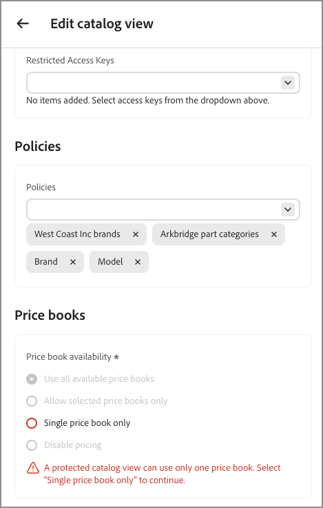

Standardmäßig ist eine [Katalogansicht](catalog-view.md) öffentlich. Beschränken Sie den Zugriff auf eine Katalogansicht, damit nur Anfragen mit einem gültigen signierten Token die Daten abrufen können.

Es gibt zwei Möglichkeiten, um eine Katalogansicht privat zu machen:

- **Automatisch für freigegebene B2B-**: Für Adobe Commerce B2B-Bereitstellungen, die Merchandising Services mit dem zusammenstellbaren Katalogdatenmodell (Composable Catalog Data Model, CCDM) verwenden, werden automatisch private Katalogansichten erstellt und konfiguriert, basierend auf der Konfiguration des freigegebenen Katalogs in [!DNL Adobe Commerce]. Siehe [Automatische private Katalogansichten für freigegebene B2B-Kataloge](#automatic-private-catalog-views-for-b2b-shared-catalogs).

- **Manuell für jede Katalogansicht** - Um den Zugriff auf eine B2C-Katalogansicht zu beschränken, die andernfalls öffentlich wäre, führen Sie die Schritte unter [Schützen einer Katalogansicht](#protect-a-catalog-view) aus. Siehe [Anwendungsfälle für eingeschränkten Zugriff](restricted-access-keys.md#restricted-access-key-use-cases) für Beispiele wie Partnerportale und Vorschauen auf die Vorabversion.

Der Katalogschutz gilt nur für die ausgewählte Katalogansicht. Die Richtlinien oder Ebenen der Ansicht werden dadurch nicht geändert. Sie beschränkt die Ansicht auf ein einzelnes Preisbuch - siehe [Preisbucheinschränkung bei privaten Katalogansichten](#price-book-restriction-on-private-catalog-views).

## Erläuterung der Schutzgrenze

Der Katalogschutz gilt nur für die Katalogansicht, in der er aktiviert ist. Es schützt Katalog- und Suchanfragen, ändert jedoch nicht die Richtlinien oder Ebenen der Ansicht, schützt andere Katalogansichten oder sichere Warenkorb-, Checkout- oder Bestellvorgänge.

Das verbundene Commerce-Backend muss die Kaufberechtigung unabhängig durchsetzen.

## Preisbuchbeschränkung für private Katalogansichten

Eine private Katalogansicht kann nur auf ein Preisbuch verweisen. Dies unterscheidet sich von einer öffentlichen Katalogansicht, für die mehrere Preisbücher verwendet werden können.

Wenn [!UICONTROL Catalog Protection] aktiviert ist, wechselt die Preisbuchauswahl im Katalogansichtsformular von einem Mehrfachauswahl-Steuerelement zu einem Einzelauswahl-Steuerelement (Optionsfeld).



- Wenn Sie [!UICONTROL Catalog Protection] für eine Katalogansicht aktivieren, der mehrere Preisbücher zugewiesen sind, können Sie die Ansicht erst speichern, wenn Sie alle Preisbücher bis auf ein entfernen.
- Wenn Sie zuvor eine private Katalogansicht mit mehreren Preisbuchzuweisungen gespeichert haben, bevor diese Einschränkung bestand, wird die Konfiguration der Katalogansicht nicht automatisch geändert. Wenn Sie die Ansicht jedoch das nächste Mal bearbeiten, müssen Sie bis auf ein Preisbuch alle Änderungen entfernen, bevor Sie die Aktualisierungen speichern können.

In jedem dieser Fälle zeigt das System die folgende Validierungsmeldung an: `A protected catalog view can use only one price book. Select 'Single price book only' to continue.`

Öffentliche Katalogansichten sind von dieser Einschränkung nicht betroffen und können weiterhin auf mehrere Preisbücher verweisen.

## Automatische private Katalogansichten für freigegebene B2B-Kataloge

[!BADGE Private beta]{type=Caution tooltip="Erfordert die Adobe Commerce Optimizer Connector B2B-Erweiterung, die sich derzeit in der privaten Beta-Version befindet."}

Bei Adobe Commerce B2B-Bereitstellungen, die Merchandising Services mit CCDM verwenden, erstellt und konfiguriert das System automatisch private Katalogansichten, basierend auf der freigegebenen Katalogkonfiguration in [!DNL Adobe Commerce]. Diese Konfiguration umfasst die Katalogansicht, die Richtlinie, einen ersten eingeschränkten Zugriffsschlüssel und eine Preisbuchreferenz. Mit dieser Konfiguration verwalten Sie eingeschränkte Zugriffsschlüssel über die Commerce-Admin-Seite **eingeschränkte Zugriffsschlüssel** (**System** > **Datenübertragung**).

Wenn Sie keine freigegebenen B2B-Kataloge verwenden - um beispielsweise eine Katalogansicht für ein Partnerportal oder eine Vorschau einer Vorabversion zu schützen -, verwenden Sie die Anweisungen unter [Schützen einer Katalogansicht](#protect-a-catalog-view), um einen manuell zu konfigurieren.

## Schützen einer Katalogansicht

>[!NOTE]
>
>Überspringen Sie dieses Verfahren für Katalogansichten, die mit freigegebenen B2B-Katalogen verknüpft sind, die vom [!DNL Adobe Commerce Optimizer Connector for B2B] verwaltet werden. Siehe [Automatische private Katalogansichten für freigegebene B2B-Kataloge](#automatic-private-catalog-views-for-b2b-shared-catalogs).

Bevor Sie beginnen, [ Sie aus dem öffentlichen Schlüssel, den Ihre Client](restricted-access-keys.md)Anwendung generiert, einen Schlüssel mit eingeschränktem Zugriff.

1. Schalten Sie in der Katalogansicht Formular erstellen oder bearbeiten **[!UICONTROL Catalog Protection]** zu **[!UICONTROL Enabled]** um.

1. Wählen Sie unter **[!UICONTROL Restricted Access Keys]** bis zu drei [Schlüssel mit eingeschränktem Zugriff](restricted-access-keys.md) aus, die dieser Katalogansicht zugewiesen werden sollen.

   {width="70%" zoomable="yes"}

1. Klicken Sie auf **[!UICONTROL Save catalog view]**.

   Die Katalogansicht ist jetzt geschützt. Nur Anfragen, die ein gültiges signiertes Token von einem zugewiesenen Schlüssel enthalten, können dessen Daten abrufen.

   >[!NOTE]
   >
   >Es kann bis zu fünf Minuten dauern, bis Änderungen an der Konfiguration für den Katalogschutz wirksam werden.

## Überprüfen, ob der Zugriff erzwungen wird

Um zu bestätigen, dass eine private Katalogansicht nicht autorisierte Anfragen ablehnt, rufen Sie ihren GraphQL-Endpunkt mit und ohne signiertes Token mithilfe der folgenden Kopfzeilen auf:

| Kopfzeile | Zweck |
| --- | --- |
| `AC-View-ID` | Die abzufragende Katalogansicht. |
| `AC-Price-Book-ID` | Das anzuwendende Preisbuch. |
| `AC-Catalog-View-Access-Token` | Der signierte JWT-Nachweis für die Autorisierung für die Katalogansicht. |

Eine Anfrage ohne gültiges Token gibt anstelle von Katalogdaten einen GraphQL-Fehler zurück, z. B.:

```json
{
  "errors": [
    {
      "message": "Access key validation failed: Missing token",
      "extensions": { "x-commerce-exception": "access-key-invalid" }
    }
  ]
}
```

Eine Anfrage mit einem Token, das von einem zugewiesenen, nicht abgelaufenen Schlüssel signiert wurde, gibt die Katalogdaten erwartungsgemäß zurück. Weitere Informationen zum Signieren eines JWT und zum Aufrufen der Merchandising-API finden Sie unter [Entwicklerdokumentation](https://developer.adobe.com/commerce/services/optimizer/merchandising-services/using-the-api#authentication).

## Verwalten eingeschränkter Zugriffsschlüssel

Wenn [!UICONTROL Catalog Protection] aktiviert ist und alle zugewiesenen Schlüssel ablaufen, wird die Katalogansicht unzugänglich. Storefronts, die auf diese Katalogansicht angewiesen sind, können keine Daten aus ihr bereitstellen. Weisen Sie einen neuen, nicht abgelaufenen Schlüssel zu, um den Zugriff wiederherzustellen. Anweisungen finden Sie unter [Drehen einer Taste](restricted-access-keys.md#rotate-a-key).

>[!NOTE]
>
>Bei Adobe Commerce B2B-Bereitstellungen mit Merchandising Services mit CCDM verwalten Sie Zugriffsschlüssel über die Commerce Admin-Seite **Eingeschränkte Zugriffsschlüssel** (**System** > **Datenübertragung**). Weitere Informationen finden Sie unter [Schlüsselverwaltung für eingeschränkten Zugriff](https://experienceleague.adobe.com/en/docs/commerce-admin/systems/data-transfer/data-sync/catalog-view-sync/restricted-access-keys) im *[!DNL Adobe Commerce Optimizer Connector]-Integrationshandbuch*.

## Ähnliche Themen

- [Katalogansichten](catalog-view.md) Erfahren Sie, wie Katalogansichten Ihren Produktkatalog nach Geschäftsstruktur, Richtlinien und Preisen organisieren.
- [Schlüssel mit eingeschränktem Zugriff](restricted-access-keys.md) - Erstellen, zuweisen und drehen Sie die Schlüssel, die zum Signieren von Token für den Katalogschutz verwendet werden.
