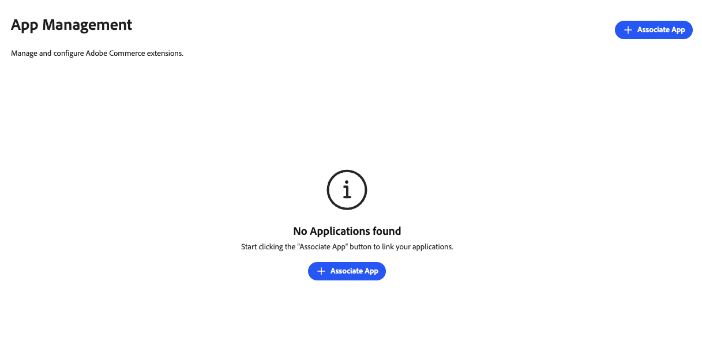
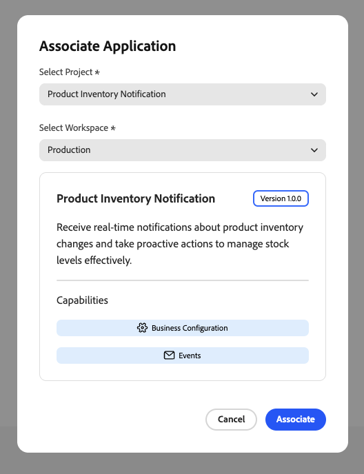
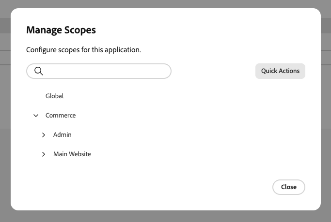

# Mobile App verwalten

Ein App Manager verknüpft ein App Builder-Programm mit seiner Commerce-Instanz. Konfigurationsformulare werden basierend auf dem Schema der App dynamisch gerendert, sodass keine benutzerdefinierte Entwicklung der Admin-Benutzeroberfläche erforderlich ist. App Manager konfiguriert Einstellungen über Formulare, die Commerce automatisch generiert.

{width="500" zoomable="yes"}

## Suchen einer Anwendung im Admin-Bereich

Unter **[!UICONTROL Apps]** > **[!UICONTROL App Management]** wird jede Anwendung als Karte angezeigt. Die Liste kann jede App enthalten, die mit der Adobe Commerce-Instanz für die ausgewählte Adobe IMS-Organisation verknüpft ist. Verwenden Sie die Steuerelemente oberhalb der Karten, um die Ergebnisse einzugrenzen:

| Kontrolle | Beschreibung |
| --- | --- |
| **Nach App filtern…** | Nach Anwendungsnamen suchen. |
| **Status** | Karten nach Lebenszyklusstatus begrenzen. **Alle Status** zeigt jede App an. Andere Werte sind **Zugeordnet**, **Installiert**, **Teilweise installiert** und **Nicht zugeordnet**. Der Status auf jeder Karte entspricht dem farbigen Indikator in der Liste. |
| **Erweiterungsmuster** | Begrenzen Sie Karten nach den Funktionen, die die App verwendet. **Alle Erweiterbarkeitsmuster** Zeigt jede App an. Andere Werte werden mit den Abzeichen auf jeder Karte abgestimmt, z. B. **Business Configuration**, **Admin UI SDK**, **Webhooks** und **Events**. |

Suchtext und beide Dropdown-Listen gelten zusammen (logisches UND). Um die vollständige Liste erneut anzuzeigen, setzen Sie **Status** und **Erweiterungsmuster** wieder auf ihre **Alle …** Optionen und löschen Sie das Suchfeld.

## Mobile App erwerben

**[!UICONTROL Acquire App]** öffnet eine neue Browser-Registerkarte (oder eine separate Browser-Ansicht) für [Adobe Exchange](https://exchange.adobe.com/experiencecloud){target="_blank"}, auf der Sie Commerce-bezogene Marktplatzlisten entdecken und Programme zu Ihrer Adobe IMS-Organisation hinzufügen können. Sobald die App erworben, genehmigt und bereitgestellt wurde, wird sie in [!DNL App Management] für ([ und Installation) ](#associate-an-app).

## Voraussetzungen

Bevor Sie eine App verknüpfen, stellen Sie Folgendes sicher:

| Anforderung | Beschreibung |
|-------------|-------------|
| **Administratorzugriff** | Commerce-Admin mit [!DNL App Management] Berechtigungen |
| **Bereitgestellte App** | App Builder-Anwendung, die in Ihrem Unternehmen bereitgestellt wird und eine Verbindung herstellen kann |
| **Organisationszugriff** | Zugriff auf die Adobe-Organisation, in der die App bereitgestellt wird |

## Tutorial

In diesem Video erfahren Sie, wie Sie eine App mit einer Commerce-Instanz verknüpfen und Einstellungen konfigurieren.

>[!VIDEO](https://video.tv.adobe.com/v/3478944)

## App verknüpfen

Der Verknüpfungsprozess importiert Websites, Stores und Store-Ansichten aus Commerce und erstellt die Verknüpfung zwischen der App und Ihrer Commerce-Instanz.

So verknüpfen Sie Ihr App Builder-Programm mit einer Commerce-Instanz:

1. Navigieren Sie zu **[!UICONTROL Apps]** > **[!UICONTROL App Management]**.

1. Klicken Sie auf **[!UICONTROL Associate App]**.

   {width="500" zoomable="yes"}

1. Wählen Sie eine **[!UICONTROL Project]** aus der Liste aus.

1. Wählen Sie die **[!UICONTROL Workspace]** aus.

1. Klicken Sie auf **[!UICONTROL Associate]**.

   {width="500" zoomable="yes"}

>[!WARNING]
>
>Wenn die Synchronisierung des Umfangs fehlschlägt, ist die Verknüpfung weiterhin abgeschlossen. Sie können die Bereiche später in der **[!UICONTROL Manage Scopes]** in der Konfiguration der zugehörigen App manuell synchronisieren.

## Einstellungen konfigurieren

Nachdem Sie eine App in der [!DNL App Management]-Ansicht verknüpft haben, konfigurieren Sie deren Einstellungen über das Formular:

1. Klicken Sie in der zugehörigen App auf **[!UICONTROL Configure]** .

1. Das Formular zeigt die konfigurierbaren Einstellungen der App an.

1. Ändern Sie die Werte nach Bedarf.

1. Klicken Sie auf **[!UICONTROL Save]**.

### Bereichsspezifische Konfiguration

Verwenden Sie eine bereichsspezifische Konfiguration, wenn verschiedene Websites, Stores oder Store-Ansichten eindeutige Einstellungen benötigen. Sie können beispielsweise eine Funktion nur für eine bestimmte Region oder Store-Ansicht aktivieren oder unterschiedliche Einstellungen pro Marke verwenden. Einstellungen mit einem niedrigeren Bereich überschreiben diejenigen mit einem höheren Bereich.

So überschreiben Sie globale Werte auf einer bestimmten Bereichsebene:

1. Klicken Sie auf **[!UICONTROL Change Scope]**.

1. Wählen Sie einen Bereich aus der Liste aus.

1. Ändern Sie die Werte für diesen Bereich.

1. Klicken Sie auf **[!UICONTROL Save]**.

## Bereiche verwalten

Greifen Sie auf **[!UICONTROL Manage Scopes]** über den Bildschirm mit den App-Details zu, um die Bereichshierarchie für Ihre App zu verwalten.

{width="500" zoomable="yes"}

| Aktion | Beschreibung |
|--------|-------------|
| **[!UICONTROL Add root scope]** | Fügen Sie einen Bereich hinzu, der nur für die App gilt. |
| **[!UICONTROL Sync Commerce scopes]** | Aktualisieren Sie die Liste der Websites, Stores und Store-Ansichten in Commerce, nachdem Sie sie hinzugefügt oder geändert haben. |
| **[!UICONTROL Import scopes]** | Bereiche stapelweise aus einer Datei importieren. |

## Verknüpfung mit einer App aufheben

Heben Sie die Verknüpfung mit einer App auf, wenn sie nicht mehr mit Ihrer Commerce-Instanz verbunden sein muss. Beispielsweise müssen Sie möglicherweise eine Integration einstellen, zu einem anderen Arbeitsbereich wechseln oder Testkonfigurationen bereinigen.

>[!WARNING]
>
> Durch Aufheben der Verknüpfung werden alle Konfigurationswerte für diese Instanz entfernt. Dies kann nicht rückgängig gemacht werden.

So entfernen Sie eine App aus einer Commerce-Instanz:

1. Navigieren Sie zu **[!UICONTROL Apps]** > **[!UICONTROL App Management]**.

1. Klicken Sie in der App auf **[!UICONTROL Unassociate]** .

1. Bestätigen Sie die Aktion.

## Verwandte Dokumentation

* [Fehlerbehebung [!DNL App Management]](troubleshooting.md) - Beheben häufiger Probleme mit der App-Zuordnung und -Konfiguration.
