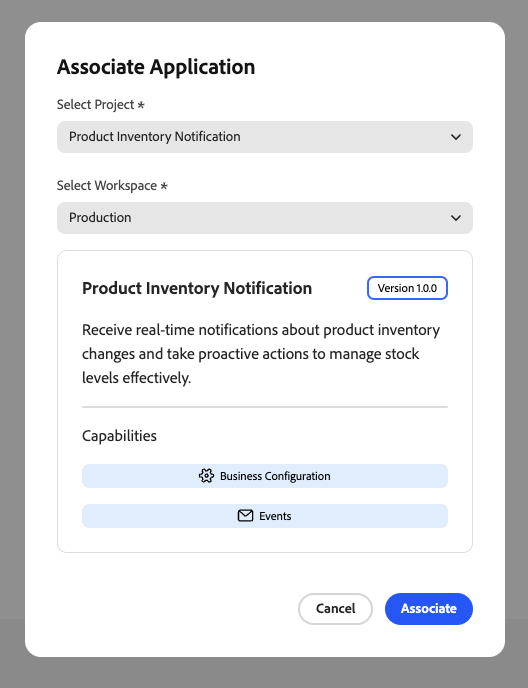

# Mobile App verwalten

Verwenden Sie [!DNL App Management], um App Builder-Anwendungen mit Ihrer Commerce-Instanz zu verknüpfen, zu installieren, zu konfigurieren, zu aktualisieren und die Verknüpfung mit ihr aufzuheben. Konfigurationsformulare werden aus dem Schema jeder Anwendung generiert, sodass Sie Einstellungen ohne benutzerdefinierte Entwicklung der Admin-Benutzeroberfläche verwalten können.

{width="500" zoomable="yes"}

## Suchen einer Anwendung im Admin-Bereich

Unter **[!UICONTROL Apps]** > **[!UICONTROL App Management]** wird jede Anwendung als Karte angezeigt. Die Liste kann jede App enthalten, die mit der Adobe Commerce-Instanz für die ausgewählte Adobe IMS-Organisation verknüpft ist. Verwenden Sie die Steuerelemente oberhalb der Karten, um die Ergebnisse einzugrenzen:

| Kontrolle | Beschreibung |
| --- | --- |
| **[!UICONTROL Filter by app...]** | Nach Anwendungsnamen suchen. |
| **[!UICONTROL Status]** | Karten nach Lebenszyklusstatus begrenzen. **[!UICONTROL All Statuses]** zeigt jede App an. Andere Werte sind **[!UICONTROL Associated]**, **[!UICONTROL Installed]**, **[!UICONTROL Partially Installed]** und **[!UICONTROL Unassociated]**. Der Status auf jeder Karte entspricht dem farbigen Indikator in der Liste. |
| **[!UICONTROL Extensibility patterns]** | Begrenzen Sie Karten nach den Funktionen, die die App verwendet. **[!UICONTROL All Extensibility Patterns]** zeigt jede App an. Andere Werte werden mit den Abzeichen auf jeder Karte abgestimmt, z. B. **[!UICONTROL Business Configuration]**, **[!UICONTROL Admin UI SDK]**, **[!UICONTROL Webhooks]** und **[!UICONTROL Events]**. |

Das Suchfeld und beide Filter gelten zusammen. Um die vollständige Liste erneut anzuzeigen, deaktivieren Sie das Suchfeld und wählen Sie **[!UICONTROL All Statuses]** und **[!UICONTROL All Extensibility Patterns]** aus.

### Überprüfen der Anwendungsdetails

Wählen Sie auf der Karte der Anwendung die Optionen **[!UICONTROL Manage]** > **[!UICONTROL Details]** aus, um Name, Beschreibung und Version der Anwendung zu überprüfen. Das Dialogfeld enthält zwei Registerkarten:

* **[!UICONTROL Details]** listet die geschäftlichen Anwendungsfälle des Programms auf, einschließlich Ereignisse und benutzerdefinierte Installationsschritte. Überprüfen Sie die Beschriftungen und Beschreibungen, um zu verstehen, was das Programm zu Commerce hinzufügt.
* **[!UICONTROL App config]** zeigt die Konfiguration der Anwendung zur Überprüfung als JSON an.

{width="600" zoomable="yes"}

{width="600" zoomable="yes"}

## Mobile App erwerben

**[!UICONTROL Acquire App]** öffnet eine neue Browser-Registerkarte (oder eine separate Browser-Ansicht) für [Adobe Exchange](https://exchange.adobe.com/apps/browse/ec){target="_blank"}, auf der Sie Commerce-bezogene Marktplatzlisten entdecken und Programme zu Ihrer Adobe IMS-Organisation hinzufügen können. Sobald die App erworben, genehmigt und bereitgestellt wurde, wird sie in [!DNL App Management] für [Verknüpfung](#associate-an-app) und [Installation](#install-an-app) angezeigt.

## Voraussetzungen

Bevor Sie eine App verknüpfen, stellen Sie Folgendes sicher:

| Anforderung | Beschreibung |
| --- | --- |
| **Administratorzugriff** | Commerce-Admin mit [!DNL App Management] Berechtigungen |
| **Bereitgestellte App** | App Builder-Anwendung, die in Ihrem Unternehmen bereitgestellt wird und eine Verbindung herstellen kann |
| **Organisationszugriff** | Zugriff auf die Adobe-Organisation, in der die App bereitgestellt wird |

## Tutorial

In diesem Video erfahren Sie, wie Sie eine App mit einer Commerce-Instanz verknüpfen und Einstellungen konfigurieren.

>[!VIDEO](https://video.tv.adobe.com/v/3478964?captions=ger)

## App verknüpfen

Der Verknüpfungsprozess importiert Websites, Stores und Store-Ansichten aus Commerce und erstellt die Verknüpfung zwischen der App und Ihrer Commerce-Instanz.

So verknüpfen Sie Ihr App Builder-Programm mit einer Commerce-Instanz:

1. Navigieren Sie zu **[!UICONTROL Apps]** > **[!UICONTROL App Management]**.

1. Klicken Sie auf **[!UICONTROL Associate App]**.

   {width="500" zoomable="yes"}

1. Wählen Sie eine **[!UICONTROL Project]** aus der Liste aus.

1. Wählen Sie die **[!UICONTROL Workspace]** aus.

1. Klicken Sie auf **[!UICONTROL Associate]**.

   {width="500" zoomable="yes"}

>[!WARNING]
>
>Wenn die Synchronisierung des Umfangs fehlschlägt, ist die Verknüpfung weiterhin abgeschlossen. Sie können die Bereiche später in der **[!UICONTROL Manage Scopes]** in der Konfiguration der zugehörigen App manuell synchronisieren.

## Installieren einer App

Verknüpfung verknüpft eine App mit Ihrer Commerce-Instanz. Bei Apps, die installierbare Komponenten enthalten, wie z. B. Ereignisse, Webhooks, Erweiterungen der Admin-Benutzeroberfläche oder benutzerdefinierte Installationsschritte, wendet die Installation diese Komponenten auf die Instanz an.

1. Öffnen Sie das Installationsdialogfeld für die zugehörige App in [!DNL App Management].

1. Überprüfen Sie die geschäftlichen Anwendungsfälle des Programms und die aufgelisteten Installationsschritte.

1. Wenn **[!UICONTROL Pre Installation Instructions]** angezeigt werden, müssen Sie diese Voraussetzungen erfüllen, bevor Sie fortfahren.

   {width="600" zoomable="yes"}

1. Klicken Sie auf **[!UICONTROL Install]**.

1. Überwachen Sie die Fortschrittsanzeigen für einzelne Elemente, bis die Installation abgeschlossen ist.

   {width="600" zoomable="yes"}

   >[!WARNING]
   >
   >Lassen Sie die Seite geöffnet, bis die Installation abgeschlossen ist. Das Schließen oder Aktualisieren der Seite kann dazu führen, dass die Installation nicht ordnungsgemäß abgeschlossen wird.

1. Stellen Sie sicher, dass **[!UICONTROL Successfully Installed]** angezeigt wird und abgeschlossene Elemente mit einem Häkchen versehen sind.

   {width="600" zoomable="yes"}

1. Füllen Sie alle von der App bereitgestellten Anweisungen nach der Installation aus und konfigurieren [&#x200B; dann bei &#x200B;](#configure-settings) die Einstellungen.

## Einstellungen konfigurieren

Nachdem Sie eine App in der [!DNL App Management]-Ansicht verknüpft haben, konfigurieren Sie deren Einstellungen über das Formular:

1. Wählen Sie auf der Karte der zugehörigen App **[!UICONTROL Manage]** > **[!UICONTROL Configure]** aus.

Das Formular zeigt die konfigurierbaren Einstellungen der App an.

1. Ändern Sie die Werte nach Bedarf.

1. Klicken Sie auf **[!UICONTROL Save]**.

### Bereichsspezifische Konfiguration

Verwenden Sie eine bereichsspezifische Konfiguration, wenn verschiedene Websites, Stores oder Store-Ansichten eindeutige Einstellungen benötigen. Sie können beispielsweise eine Funktion nur für eine bestimmte Region oder Store-Ansicht aktivieren oder unterschiedliche Einstellungen pro Marke verwenden. Einstellungen mit einem niedrigeren Bereich überschreiben diejenigen mit einem höheren Bereich.

So überschreiben Sie globale Werte auf einer bestimmten Bereichsebene:

1. Klicken Sie auf **[!UICONTROL Change Scope]**.

1. Wählen Sie einen Bereich aus der Liste aus.

1. Ändern Sie die Werte für diesen Bereich.

1. Klicken Sie auf **[!UICONTROL Save]**.

## Bereiche verwalten

Greifen Sie auf **[!UICONTROL Manage Scopes]** über den Bildschirm mit den App-Details zu, um die Bereichshierarchie für Ihre App zu verwalten.

{width="500" zoomable="yes"}

| Aktion | Beschreibung |
| --- | --- |
| **[!UICONTROL Add root scope]** | Fügen Sie einen Bereich hinzu, der nur für die App gilt. |
| **[!UICONTROL Sync Commerce scopes]** | Aktualisieren Sie die Liste der Websites, Stores und Store-Ansichten in Commerce, nachdem Sie sie hinzugefügt oder geändert haben. |
| **[!UICONTROL Import scopes]** | Bereiche stapelweise aus einer Datei importieren. |

## Aktualisieren einer App

Wenn Ihr App-Entwickler eine neue Version einer installierten App bereitstellt, wird [!DNL App Management] benachrichtigt, dass ein Upgrade verfügbar ist. Die App Builder-Bereitstellung und ein App-Management-Upgrade sind separate Vorgänge: Bei dem Upgrade werden geplante Änderungen an installierten Komponenten wie Ereignissen, Webhooks und Erweiterungen der Admin-Benutzeroberfläche angewendet.

Bitten Sie Ihren App-Entwickler zu bestätigen, dass die App Upgrades unterstützt. Informationen zu den SDK-Voraussetzungen und Migrationsanforderungen finden Sie unter [Upgrade Ihrer App](https://developer.adobe.com/commerce/extensibility/app-management/upgrade-app/){target="_blank"} in der Entwicklerdokumentation.

### Überprüfen und Starten eines Upgrades

Im manuellen Modus (dem Standardmodus) überprüfen und starten Sie das Upgrade in [!DNL App Management].

1. Notieren Sie sich die installierte Anwendungsversion und -konfiguration und sichern Sie Anwendungsdaten und externe Ressourcen mithilfe Ihres Anwendungsentwicklers.

1. Navigieren Sie zu **[!UICONTROL Apps]** > **[!UICONTROL App Management]** und öffnen Sie das verfügbare Upgrade für die App.

1. Überprüfen Sie die geplanten Änderungen und alle Warnungen. Bei einem Upgrade können Komponenten hinzugefügt, geändert oder entfernt werden. Wenn ein benutzerdefinierter Installationsschritt entfernt wird, wird das zugehörige Deinstallationsskript nicht ausgeführt und die von ihm erstellten Ressourcen werden nicht automatisch bereinigt. Bestätigen Sie die erforderliche Bereinigung mit Ihrem App-Entwickler, bevor Sie fortfahren.

1. Starten Sie das Upgrade und überwachen Sie den Fortschritt der aufgelisteten Vorgänge.

1. Überprüfen Sie das Upgrade-Ergebnis und suchen Sie nach fehlgeschlagenen Vorgängen. Wenn das Upgrade fehlschlägt, befolgen Sie [Upgrade schlägt &#x200B;](troubleshooting.md#upgrade-fails), bevor Sie **[!UICONTROL Retry Upgrade]** verwenden.

Im manuellen Modus werden geplante Änderungen an installierten Commerce-Komponenten erst dann angewendet, wenn Sie das Upgrade starten. Bei der Bereitstellung kann der Laufzeitaktions-Code, den die installierte App bereits verwendet, jedoch vor Ausführung des Upgrades aktualisiert werden.

### Automatische Upgrades

Ihr App-Entwickler steuert den Upgrade-Modus. Bitten Sie Ihren Entwickler zu bestätigen, ob die App manuelle oder automatische Upgrades verwendet.

>[!WARNING]
>
>Automatische Upgrades sind experimentell und beginnen nach der Bereitstellung ohne Administratorüberprüfung, einschließlich benutzerdefinierter Installationsskripte, die externe Ressourcen ändern können. Koordinieren Sie sich mit Ihrem Entwickler, bevor automatische Upgrades aktiviert werden, auch wenn eine neu bereitgestellte Version den Modus von manuell in automatisch ändert.

### Änderungen an der Geschäftskonfiguration

Änderungen am Geschäftskonfigurationsschema der App werden nach der Bereitstellung automatisch angezeigt. Sie sind von Installation und Upgrades getrennt und stellen keinen Trigger für ein App-Upgrade dar.

## Verknüpfung mit einer App aufheben

Heben Sie die Verknüpfung mit einer App auf, wenn sie nicht mehr mit Ihrer Commerce-Instanz verbunden sein muss. Beispielsweise müssen Sie möglicherweise eine Integration einstellen, zu einem anderen Arbeitsbereich wechseln oder Testkonfigurationen bereinigen.

>[!WARNING]
>
>Durch Aufheben der Verknüpfung werden alle Konfigurationswerte für diese Instanz entfernt. Dies kann nicht rückgängig gemacht werden. Bei der Deinstallation können Sie auch App-Komponenten und -Ressourcen über benutzerdefinierte Deinstallationsskripte entfernen.

Notieren Sie sich vor dem Fortfahren die installierte Version und Konfiguration, sichern Sie die Anwendungsdaten und fragen Sie Ihren App-Entwickler, welche Ressourcen die Deinstallationsskripte der App entfernen und welche manuell bereinigt werden müssen. Planen Sie etwaige Dienstunterbrechungen und wie Sie die App, ihre Einstellungen und ihre Daten wiederherstellen können. Für routinemäßige Aktualisierungen [&#x200B; Sie die App aktualisieren](#upgrade-an-app) anstatt die Verknüpfung aufzuheben.

So entfernen Sie eine App aus einer Commerce-Instanz:

1. Navigieren Sie zu **[!UICONTROL Apps]** > **[!UICONTROL App Management]**.

1. Wählen Sie auf der Karte der App **[!UICONTROL Manage]** > **[!UICONTROL Unassociate]** aus.

1. Überprüfen Sie die aufgelisteten geschäftlichen Anwendungsfälle und Komponenten, die von der Deinstallation betroffen sind, einschließlich Ereignissen und benutzerdefinierten Installationsschritten.

   {width="600" zoomable="yes"}

1. Bestätigen Sie die Aktion.

## Verwandte Dokumentation

* [Fehlerbehebung [!DNL App Management]](troubleshooting.md) - Beheben häufiger Probleme mit der Verknüpfung, Installation, Konfiguration und Aktualisierung.
* [Upgrade Ihrer App](https://developer.adobe.com/commerce/extensibility/app-management/upgrade-app/){target="_blank"} - Entwickleranforderungen an Upgrade-Modi, Migrationsskripte und Diagnosen.
