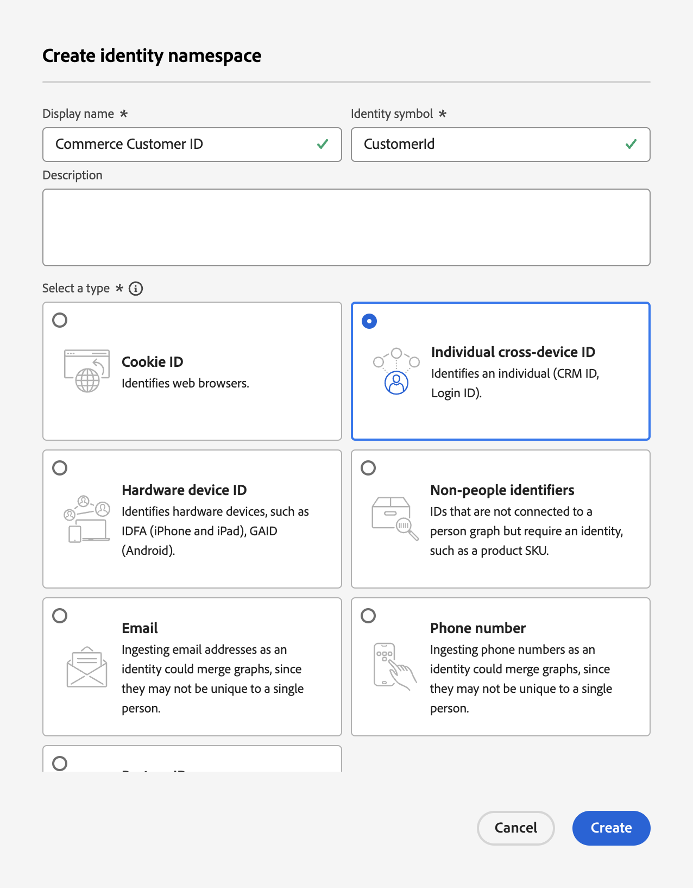

# Aktualisieren des Profildatensatzschemas für die Commerce-Datenaufnahme

Wenn Ihre Kunden ein Profil auf Ihrer Commerce-Site erstellen, wird ein Profildatensatz erstellt und die Daten werden erfasst. Sie müssen ein Schema und einen Datensatz speziell für diesen Profildatensatz erstellen, bevor Sie diese Profildaten an die Experience Platform streamen können.

1. [Erstellen](https://experienceleague.adobe.com/de/docs/experience-platform/xdm/ui/resources/schemas) eines Schemas und Festlegen der Klasse auf **Individuelles Profil**.

1. [Hinzufügen](https://experienceleague.adobe.com/de/docs/experience-platform/xdm/ui/resources/schemas) die folgenden profilspezifischen Feldergruppen:

   - identityMap
   - Demografische Details
   - Persönliche Kontaktdaten
   - Details zum Benutzerkonto

1. [Aktivieren](https://experienceleague.adobe.com/de/docs/experience-platform/xdm/ui/resources/schemas) Sie das Schema für das Profil.

   Wenn ein Schema für das Profil aktiviert ist, werden alle Datensätze, die aus diesem Schema erstellt werden, in Real-Time CDP einbezogen, wobei Daten aus unterschiedlichen Quellen zusammengeführt werden, um eine vollständige Ansicht jedes Kunden zu erstellen.

1. [Erstellen eines Datensatzes](https://experienceleague.adobe.com/de/docs/platform-learn/implement-mobile-sdk/experience-cloud/platform) basierend auf dem von Ihnen erstellten oder aktualisierten Schema.

   Ein Datensatz ist ein Konstrukt zur Datenspeicherung und -verwaltung, normalerweise eine Tabelle, die ein Schema (Spalten) und Felder (Zeilen) enthält. Datensätze enthalten auch Metadaten, die verschiedene Aspekte der in ihnen gespeicherten Daten beschreiben.

1. Erstellen Sie [&#x200B; Experience Platform einen &#x200B;](https://experienceleague.adobe.com/de/docs/experience-platform/identity/features/namespaces#create-namespaces)benutzerdefinierten Namespace“ mit den folgenden Werten:

   - **Anzeigename**: _Commerce-Kunden-ID_
   - **Identitätssymbol**: _CustomerId_
   - **Type**: _Individuelle geräteübergreifende ID_

   {width="700" zoomable="yes"}

   Klicken Sie auf **[!UICONTROL Create]**. Der Service für einheitliche Profile verwendet einen benutzerdefinierten Namespace zum Zusammenfügen von Profilfragmenten.

Wenn das Schema, der Datensatz und der benutzerdefinierte Namespace für Kundenprofildatensatzdaten konfiguriert sind, können Sie Ihre Commerce[Instanz so konfigurieren](connect-data.md#data-collection) dass diese Daten erfasst und an Experience Platform gesendet werden.

Informationen zum Erstellen eines Schemas, Datensatzes und Datenstroms für Verhaltens- und Backoffice-Ereignisdaten finden Sie unter [Aktualisieren von Zeitreihen-Ereignisschemas für die Commerce-Datenaufnahme](update-xdm.md).
