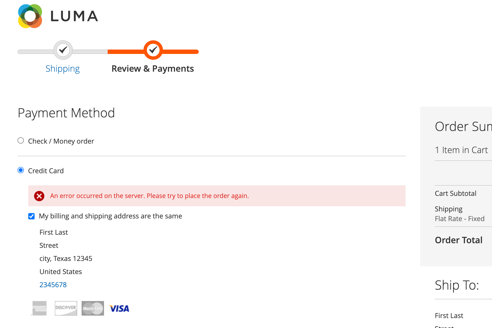

# Checkout in [!DNL Payment Services]

Sie können den Checkout für Adobe Commerce [!DNL Payment Services] so konfigurieren, dass er Ihren Kundinnen und Kunden am besten entspricht. Funktionen wie [automatische &#x200B;](#order-auto-voided-if-error) bestellen) und [Tresor für Kreditkarten](#credit-card-vaulting) stellen sicher, dass Ihre Kunden ein reibungsloses Benutzererlebnis haben.

## Bei Fehler automatisch storniert bestellen

Tritt während des Checkouts ein Fehler auf, wird die Bestellung automatisch storniert bzw. storniert [!DNL Payment Services].

Auf der Kaufbestätigungsseite wird eine Fehlermeldung für den Käufer angezeigt. Die Meldung kann variieren.

{width="600" zoomable="yes"}

Ein Kommentar zur stornierten Bestellung wird auch im Administrator für eine bestimmte [Bestellung](https://experienceleague.adobe.com/en/docs/commerce-admin/stores-sales/order-management/orders/orders?lang=en) angezeigt.

{width="600" zoomable="yes"}

Wenn ein Käufer die Genehmigung für eine Bestellung erhält, die Bestellung jedoch nicht erstellt und in eine `Capture` umgewandelt wurde, wird die Bestellung automatisch storniert. Dadurch wird sichergestellt, dass kein Kredit auf der Kreditkarte des Käufers reserviert wird, und die Gebühr des Zahlungsdienstleisters vermieden, die anfällt, wenn die Autorisierung am Ende der standardmäßigen 29-Tage-Frist ungültig wird.

>[!NOTE]
>
>Die automatische Stornierung einer Bestellung tritt nur auf, wenn der Kunde eine Zahlungsmethode verwendet, die auf den `Authorize`-Modus, nicht auf den `Authorize and Capture`-Modus eingestellt ist.

## Checkout von der Produktseite

Wenn ein Kunde direkt über die Produktseite mit den Schaltflächen PayPal oder [!DNL Pay Later] auscheckt, wird nur der auf der aktuellen Produktseite dargestellte Artikel gekauft. Artikel, die sich bereits im Warenkorb des Kunden befinden, werden nicht zum Checkout-Ablauf hinzugefügt und nicht gekauft.

Mit dieser Funktion kann der Kunde schnell den Artikel kaufen, den er gerade anzeigt, während er zuvor zum Warenkorb hinzugefügte Artikel beibehält.
Wenn der Kunde die Bestellung storniert, wird der Artikel auf der aktuellen Produktseite zum Warenkorb des Kunden hinzugefügt.

Wenn ein Kunde über die Produktseite in den Checkout-Fluss eintritt, wird die Checkout-Seite vereinfacht: Die Ansicht zeigt nur auftragsbezogene Daten und Optionen an.

## Tresor mit Kreditkarte

Käufer können ihre Kreditkarteninformationen für zukünftige Käufe auf der Website-Ebene (jedes Geschäft innerhalb des Kontos desselben Händlers) Vault-nutzen oder „speichern“.

Siehe [Kreditkartenabwicklung](vaulting.md) für weitere Informationen
