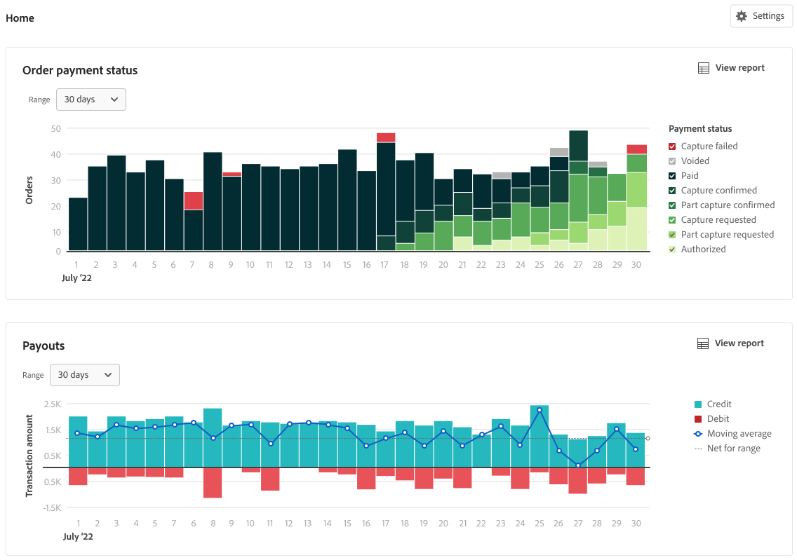

# Finanzberichterstattung

[!DNL Payment Services] für [!DNL Adobe Commerce] und [!DNL Magento Open Source] bietet Ihnen ein umfassendes Reporting, damit Sie einen klaren Überblick über die Bestellungen und Zahlungen Ihres Geschäfts erhalten.

{width="600" zoomable="yes"}

Die Cashflow-Management-Berichte - Auszahlungen, Transaktionen und Auftragszahlungsstatus - synchronisieren Zahlungsdetails mit Auftragsinformationen, um Ihnen volle Transparenz über verarbeitetes Volumen, Zahlungssaldo und detaillierte Berichte auf Transaktionsebene für die finanzielle Abstimmung zu bieten.

>[!NOTE]
>
>Ihre Bereitstellung bestimmt, welche dieser Berichte im [!DNL Payment Services] (**) angezeigt**. Auf [!DNL Adobe Commerce as a Cloud Service] und [!DNL Adobe Commerce Optimizer] zeigt das Dashboard **ausgewählte** Berichte (einschließlich [Transaktionen](reporting.md) von der Startseite) an. [Bestellzahlstatus](order-payment-status.md) und [Auszahlungen](payouts.md) Startansichten und verknüpfte Berichte sind in Adobe Commerce in der Cloud und On-Premise verfügbar, wie in diesen Themen beschrieben. Siehe [[!DNL Payment Services] Home](payments-home.md).
