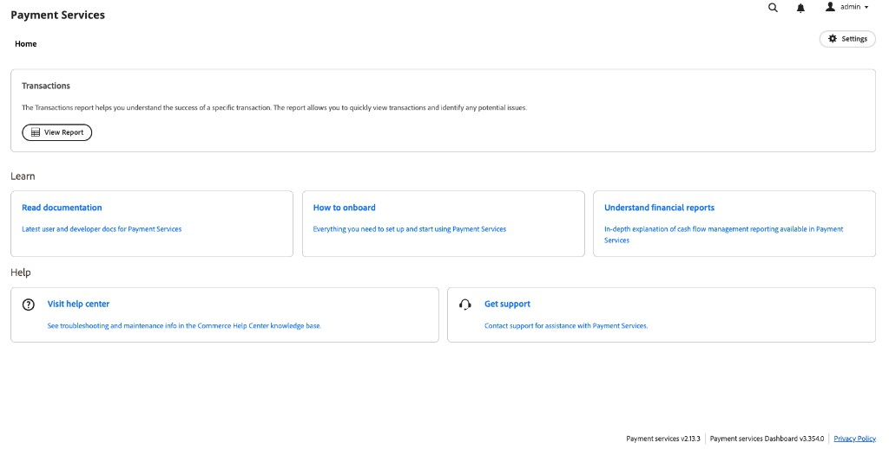

# [!DNL Payment Services] Home

[!DNL Payment Services] für Adobe Commerce und Magento Open Source bietet eine Startansicht mit den Informationen, die Sie zum Einrichten und Verwenden der Erweiterung benötigen. Die Optionen oben auf der Startseite hängen von Ihrer Bereitstellung ab: Adobe Commerce on Cloud oder On-Premise (PaaS) oder [!DNL Adobe Commerce as a Cloud Service] oder [!DNL Adobe Commerce Optimizer] (SaaS).

Navigieren Sie in der _Admin_-Seitenleiste zu **[!UICONTROL Sales]** > **[!UICONTROL [!DNL Payment Services]]**:

>[!BEGINTABS]

>[!TAB Adobe Commerce on Cloud und On-Premise]

{width="700" zoomable="yes"}

>[!TAB Adobe Commerce as a Cloud Service und Commerce Optimizer]

Bis zum Abschluss des Onboarding werden **[!UICONTROL Home]** Folgendes **[!UICONTROL ACCS Onboarding Required]**. Die Benachrichtigung ist verknüpft mit [Einrichten des Sandbox-Service](sandbox.md#sandbox-onboarding) (mit einem Test-PayPal-Verarbeitungskonto) oder mit [Aktivieren von Live-Zahlungen](production.md#enable-live-payments) wenn Sie bereits in einer anderen Umgebung getestet haben:

{width="700" zoomable="yes"}

Nach Abschluss des Onboarding (oder auf einer bereits konfigurierten Instanz) zeigt **[!UICONTROL Home]** **[!UICONTROL Transactions]** mit **[!UICONTROL View Report]** für den tabellarischen Bericht sowie die **[!UICONTROL Learn]** und **[!UICONTROL Help]** Bereiche an:

{width="700" zoomable="yes"}

>[!ENDTABS]

In dieser Startansicht können Sie auf _Startseite_, _Erfahren_ über [!DNL Payment Services] zugreifen, die Erweiterung _Einstellungen_ konfigurieren oder _Hilfe_. Verwenden Sie **[!UICONTROL View Report]** (SaaS) oder die **[!UICONTROL Orders]** und **[!UICONTROL Payouts]** Einstiegspunkte (Adobe Commerce on Cloud und On-Premise), um das Reporting zu öffnen; siehe [Reporting](reporting.md).

>[!NOTE]
>
>In [!DNL Adobe Commerce as a Cloud Service] und [!DNL Adobe Commerce Optimizer] macht das [!DNL Payment Services] **Dashboard** nur **ausgewählte** Berichte verfügbar: Sie erhalten den Bericht von **[!UICONTROL Home]** (siehe SaaS-Tabelle unten). Die Bereiche **[!UICONTROL Orders]** und **[!UICONTROL Payouts]** auf der Startseite - sowie deren Diagramme und verknüpfte Berichte - gelten nur für Adobe Commerce on Cloud und On-Premise [PaaS](#home). Einen Überblick über Cashflow-Berichte in verschiedenen Bereitstellungen finden Sie unter [Finanzberichte](financial-reporting.md).

## Startseite

[!BADGE Nur PaaS]{type=Informative url="https://experienceleague.adobe.com/en/docs/commerce/user-guides/product-solutions" tooltip="Gilt nur für Adobe Commerce in Cloud-Projekten (von Adobe verwaltete PaaS-Infrastruktur) und lokale Projekte."}

| Feld | Beschreibung |
|---|---|
| [!UICONTROL Orders] | Diese Berichte ermöglichen es Ihnen, den Zahlungsstatus Ihrer Bestellungen schnell anzuzeigen und mögliche Probleme zu identifizieren. |
| [!UICONTROL Payouts] | Die Auszahlungsberichte zeigen umfassende Auszahlungsinformationen auf einen Blick und ermöglichen Ihnen volle Transparenz in Bezug auf den Zahlungsbetrag, das verarbeitete Volumen und detaillierte Berichte auf Transaktionsebene für die finanzielle Abstimmung. |

[!BADGE nur SaaS]{type=Positive url="https://experienceleague.adobe.com/en/docs/commerce/user-guides/product-solutions" tooltip="Gilt nur für Adobe Commerce as a Cloud Service- und Adobe Commerce Optimizer-Projekte (von Adobe verwaltete SaaS-Infrastruktur)."}

| Feld | Beschreibung |
|---|---|
| [!UICONTROL Transactions] | Fasst den Transaktionsbericht zusammen, der Ihnen hilft, das Ergebnis bestimmter Transaktionen zu verstehen. Klicken Sie auf **[!UICONTROL View Report]** , um das Raster der Transaktionen zu öffnen (z. B. Bestell- und PayPal-Transaktions-IDs, Zahlungsmethode, Ergebnis und Antwort-Codes). Siehe [Ansicht der Transaktionsberichte](reporting.md#transactions-report-view). |

## Mehr erfahren

| Feld | Beschreibung |
|---|---|
| [!UICONTROL Read documentation] | Siehe die neuesten Benutzer- und Entwicklerdokumente für [!DNL Payment Services]. |
| [!UICONTROL How to onboard] | Hier finden Sie alles, was Sie zum Einrichten und Verwenden der [!DNL Payment Services]-Funktion benötigen. |
| [!UICONTROL Understand financial reports] | Ausführliche Erläuterung der Berichterstattung über das Cashflow-Management in [!DNL Payment Services]. |

## Hilfe

| Feld | Beschreibung |
|---|---|
| [!UICONTROL Visit help center] | Das [!DNL Adobe Commerce]-Hilfezentrum bietet Wissensdatenbankartikel über [!DNL Payment Services]. |
| [!UICONTROL Get support] | Besuchen Sie das [!DNL Adobe Commerce] Support-Portal , um Hilfe bei der [!DNL Payment Services] zu erhalten. |

## Einstellungen

Klicken Sie in der Startansicht auf **[!UICONTROL Settings]**. Weitere Informationen finden [[!DNL Payment Services]  unter ](configure-admin.md)Konfiguration“.

In der Fußzeile des Bereichs Zahlungsdienste werden die Versionsbezeichnungen **Zahlungsdienste** und **Zahlungsdienste-Dashboard** angezeigt, z. B. wenn Sie Details für den Support erfassen.
